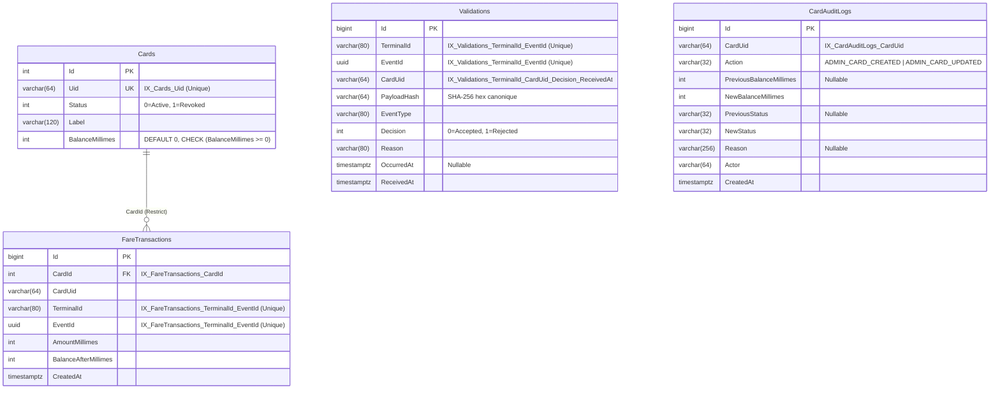
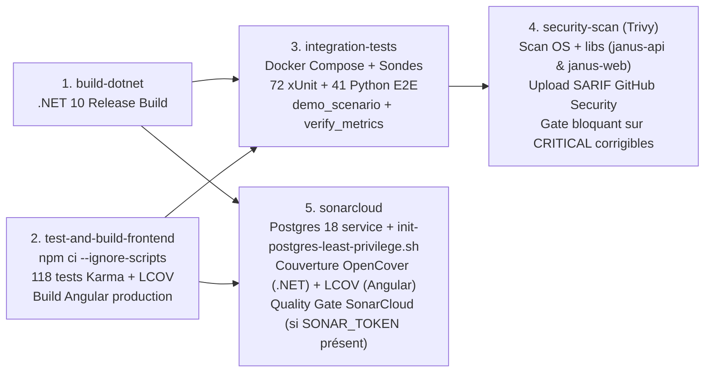

# JANUS RFID — Secure Transport Ticketing Platform

**Documentation officielle de référence du projet d'ingénierie — État vérifié au 31 octobre 2026**

- **Branche de référence :** `main` (intégrant la chaîne complète des Lots 1 à 2C.1 jusqu'au commit `849650ed5c5decd8cbe66187757bafc557b66894` issu de `fix/lot-2c1-migrator-exit-and-prod-guards`)
- **Jalon historique précédent (`main` avant Lot 1) :** `0bd75e681cc163c0652ff031820fb76b365723df` (PR #25)
- **Technologies principales :** ASP.NET Core 10 Minimal APIs (C# / `.NET 10.0`), Entity Framework Core 10.0.0, PostgreSQL 18, Angular 19.2 (TypeScript 5.7), Nginx 1.27 Alpine, OpenTelemetry 1.20, Prometheus v2.54.1, Grafana 11.2.0, Docker Compose, GitHub Actions, SonarCloud, Trivy v0.36.0.

> [!WARNING]
> **Statut de qualification et avertissement d'exploitation :**
> **JANUS RFID** est un prototype d'ingénierie logicielle et DevSecOps (Projet de Fin d'Études — ESPRIT) conçu pour démontrer la rigueur transactionnelle, le cloisonnement des privilèges et l'observabilité d'un système central de billettique de transport.
> - **Couche matérielle RFID simulée :** Le système ne pilote pas de lecteur NFC/RFID physique ni de module matériel cryptographique SAM (*Secure Access Module*) / puce MIFARE DESFire EV3. Les passages de titres sont émulés par des identifiants UID transmis via API REST par le simulateur Angular ou les scripts Python.
> - **Non qualifié pour la production en l'état :** Le déploiement local fonctionne en HTTP (sans terminaison TLS/HTTPS active) et les journaux d'audit ne sont pas encore répliqués vers un puits externe immuable (WORM/SIEM).

---

## Sommaire

1. [Vue d'ensemble et objectifs](#1-vue-densemble-et-objectifs)
2. [Stack technique vérifiée](#2-stack-technique-vérifiée)
3. [Architecture technique](#3-architecture-technique)
4. [Arborescence complète du dépôt](#4-arborescence-complète-du-dépôt)
5. [Catalogue exhaustif des fonctionnalités](#5-catalogue-exhaustif-des-fonctionnalités)
6. [Documentation détaillée des API REST](#6-documentation-détaillée-des-api-rest)
7. [Modèle de données et migrations EF Core](#7-modèle-de-données-et-migrations-ef-core)
8. [Garanties transactionnelles et financières](#8-garanties-transactionnelles-et-financières)
9. [Sécurité et modèle de confiance](#9-sécurité-et-modèle-de-confiance)
10. [Configuration et variables d'environnement](#10-configuration-et-variables-denvironnement)
11. [Installation, démarrage local et exploitation](#11-installation-démarrage-local-et-exploitation)
12. [Tests automatisés et validation](#12-tests-automatisés-et-validation)
13. [CI/CD et chaîne DevSecOps](#13-cicd-et-chaîne-devsecops)
14. [Historique des lots d'ingénierie (Lots P1 à 2C.1)](#14-historique-des-lots-dingénierie-lots-p1-à-2c1)
15. [État du projet au 31 octobre 2026 — documentation de référence](#15-état-du-projet-au-31-octobre-2026--documentation-de-référence)
16. [Limites et risques connus](#16-limites-et-risques-connus)
17. [Contribution, qualité et maintenance documentaire](#17-contribution-qualité-et-maintenance-documentaire)
18. [Glossaire et références internes](#18-glossaire-et-références-internes)

---

## 1. Vue d'ensemble et objectifs

### 1.1 Problème métier visé
Dans un réseau de transport public, les bornes de validation soumettent des événements de passage soumis à de fortes contraintes de concurrence, de latence et d'instabilité réseau (retransmissions après perte d'acquittement, tentatives de double passage, erreurs d'opérateur). Sans garanties transactionnelles strictes au niveau de la base de données et de l'API, un système billettique s'expose à :
- des **doubles débits** lors de la retransmission d'un même événement de passage après une micro-coupure ;
- des **soldes négatifs** (*race conditions* de type *check-then-act* lorsque deux validations concurrentes ciblent la même carte) ;
- des **fraudes par repassage immédiat** (*passback*) d'une même carte sur un même valideur ;
- une **compromission latérale** si une borne de validation ou le compte applicatif de l'API dispose de privilèges administratifs ou DDL sur la base de données.

### 1.2 Acteurs et rôles implémentés
L'authentification et le contrôle d'accès reposent sur trois rôles serveur définis dans [`src/Janus.Api/Security/JanusTokenAuthHandler.cs`](src/Janus.Api/Security/JanusTokenAuthHandler.cs) et six politiques d'autorisation dans [`src/Janus.Api/Program.cs`](src/Janus.Api/Program.cs) :

| Acteur / Rôle (`ClaimTypes.Role`) | Identités serveur configurées | Permissions attribuées (`Claim "permission"`) | Capacités effectives |
| :--- | :--- | :--- | :--- |
| **`Terminal`** | `TERMINAL-DEMO-01`, `TERMINAL-DEMO-02` | `validations:create`, `cards:read`, `dashboard:read` | Soumettre des validations (`POST /api/validations`), vérifier la présence/statut d'une carte sans voir son solde (`GET /api/simulator/cards`, `GET /api/simulator/cards/{uid}/presence`), consulter les agrégats du tableau de bord (`GET /api/dashboard/summary`). |
| **`Admin`** | `ADMIN` | `cards:admin`, `cards:read`, `audit:read`, `metrics:scrape`, `demo:read`, `dashboard:read` | Créer, recharger, activer ou révoquer des cartes (`PUT /api/cards/{uid}`), consulter l'inventaire et les soldes (`GET /api/cards`, `GET /api/demo/cards`, `GET /api/cards/{uid}`), auditer l'historique administratif (`GET /api/cards/{uid}/audit`), lire `/metrics`. Interdit sur `POST /api/validations` (`403 Forbidden`). |
| **`Scraper`** | `PROMETHEUS-SCRAPER` | `metrics:scrape` | Accéder exclusivement à `GET /metrics` pour la collecte Prometheus (`403 Forbidden` sur toute autre route). |

### 1.3 Parcours fonctionnel d'une validation billettique
1. La borne authentifiée transmet un événement `POST /api/validations` contenant `eventId` (UUID généré par le terminal), `cardUid`, `occurredAt` (optionnel) et `eventType` (`"TRANSPORT_VALIDATION"`).
2. L'API détermine l'identité du terminal (`terminalId`) **exclusivement à partir du jeton Bearer authentifié côté serveur** (jamais depuis le corps JSON).
3. L'API normalise `cardUid` (`Trim().ToUpperInvariant()`) et calcule l'empreinte SHA-256 canonique (`PayloadHash`) du triplet `(eventId, cardUid, occurredAt, eventType)`.
4. **Pré-vérification d'idempotence :** si `(terminalId, eventId)` existe déjà dans `Validations` :
   - si `PayloadHash` est identique, l'API renvoie `200 OK` avec `duplicate = true` et la décision initiale, sans toucher au solde ;
   - si `PayloadHash` diffère, l'API renvoie `409 Conflict` (`idempotency_conflict`).
5. **Transaction atomique sous verrou pessimiste :** l'API ouvre une transaction `ReadCommitted`, applique `SET LOCAL lock_timeout` et `SET LOCAL statement_timeout`, puis verrouille la ligne de la carte via `SELECT * FROM "Cards" WHERE "Uid" = @p0 FOR UPDATE`.
6. L'API évalue successivement : l'existence de la carte (`UNKNOWN_CARD`), son statut (`CARD_REVOKED`), la fenêtre Anti-Passback sur la même borne (`PASSBACK_VIOLATION`), puis la suffisance du solde (`INSUFFICIENT_FUNDS`).
7. Si toutes les conditions sont satisfaites (`ACTIVE_CARD`), le tarif (`Fare:AmountMillimes`, par défaut `1500` millimes) est déduit en entier (`int`), une ligne `FareTransaction` et une ligne `ValidationEvent` (`Decision = Accepted`) sont insérées dans la même transaction SQL. En cas de rejet métier, seule la trace `ValidationEvent` (`Decision = Rejected`) est enregistrée avec un débit de `0`.

### 1.4 Distinction entre périmètre actuel et cible future
- **Implémenté aujourd'hui :** validation centralisée en ligne via API REST, persistance transactionnelle PostgreSQL 18, isolation du migrateur `db-migrator`, moindre privilège SQL (`janus_runtime`), audit administratif protégé par triggers SQL, supervision OpenTelemetry/Prometheus/Grafana et interface Angular 19.
- **Non couvert / évolutions futures :** lecture matérielle NFC/RFID (ISO 14443 / MIFARE DESFire), authentification cryptographique mutuelle carte-lecteur par SAM matériel, mode hors-ligne embarqué sur valideur (*Edge-to-Cloud* avec listes blanches/noires locales et synchronisation différée), terminaison TLS/HTTPS de production et puits d'audit externe WORM/SIEM.

---

## 2. Stack technique vérifiée

Toutes les versions ci-dessous sont extraites des fichiers de projet et manifestes du dépôt ([`src/Janus.Api/Janus.Api.csproj`](src/Janus.Api/Janus.Api.csproj), [`tests/Janus.Api.Tests/Janus.Api.Tests.csproj`](tests/Janus.Api.Tests/Janus.Api.Tests.csproj), [`src/Janus.Web/package.json`](src/Janus.Web/package.json), [`compose.yaml`](compose.yaml), [`.github/workflows/ci.yml`](.github/workflows/ci.yml)).

| Composant | Technologie | Version vérifiée | Rôle dans le projet | Emplacement | Statut |
| :--- | :--- | :--- | :--- | :--- | :--- |
| **Backend API** | ASP.NET Core Minimal APIs (.NET) | `.NET 10.0` (`net10.0`, image `mcr.microsoft.com/dotnet/aspnet:10.0`) | API REST billettique, authentification, RBAC, rate limiting, résilience transactionnelle | [`src/Janus.Api/`](src/Janus.Api/) | `IMPLÉMENTÉ ET TESTÉ` |
| **ORM & Accès SQL** | Entity Framework Core + Npgsql | `10.0.0` (`Npgsql.EntityFrameworkCore.PostgreSQL` `10.0.0`) | Mapping relationnel, requêtes `FOR UPDATE`, migrations versionnées | [`src/Janus.Api/Models.cs`](src/Janus.Api/Models.cs), [`src/Janus.Api/Migrations/`](src/Janus.Api/Migrations/) | `IMPLÉMENTÉ ET TESTÉ` |
| **Sécurité Crypto PKCS** | `System.Security.Cryptography.Pkcs` | `10.0.13` | Correctif explicite de dépendance transitive (GHSA-846f-f764-76mx) | [`src/Janus.Api/Janus.Api.csproj`](src/Janus.Api/Janus.Api.csproj) | `IMPLÉMENTÉ ET TESTÉ` |
| **Base de données** | PostgreSQL | `18` (`postgres:18` en Compose, `postgres:18-alpine` en job CI SonarCloud) | Persistance relationnelle ACID, verrous de lignes, triggers d'immuabilité d'audit | [`compose.yaml`](compose.yaml), [`scripts/init-postgres-least-privilege.sh`](scripts/init-postgres-least-privilege.sh) | `IMPLÉMENTÉ ET TESTÉ` |
| **Migrateur DB** | Conteneur one-shot `db-migrator` | `.NET 10.0` (`Database__MigrateOnly="true"`) | Application isolée des migrations EF Core et provisionnement SQL au démarrage | [`compose.yaml`](compose.yaml), [`src/Janus.Api/Program.cs`](src/Janus.Api/Program.cs) | `IMPLÉMENTÉ ET TESTÉ` |
| **Frontend SPA** | Angular + TypeScript + RxJS | Angular `^19.2.0` (`@angular/cli` `^19.2.27`), TypeScript `~5.7.2`, RxJS `~7.8.0` | Interface de supervision, gestion des cartes, audit et simulateur de bornes | [`src/Janus.Web/`](src/Janus.Web/) | `IMPLÉMENTÉ ET TESTÉ` |
| **Serveur Web & Proxy** | Nginx Alpine (non-root) | `nginx:1.27-alpine` (build `node:22-alpine`) | Serveur d'actifs statiques Angular, reverse proxy `/api/` et `/health`, en-têtes HTTP de sécurité | [`src/Janus.Web/Dockerfile`](src/Janus.Web/Dockerfile), [`src/Janus.Web/nginx.conf`](src/Janus.Web/nginx.conf) | `IMPLÉMENTÉ ET TESTÉ` |
| **Instrumentation** | OpenTelemetry .NET | `1.20.0` (Exporter Prometheus `1.20.0-beta.1`) | Compteurs et histogrammes métier/sécurité exposés sur `/metrics` | [`src/Janus.Api/JanusMetrics.cs`](src/Janus.Api/JanusMetrics.cs) | `IMPLÉMENTÉ ET TESTÉ` |
| **Collecte Métriques** | Prometheus | `prom/prometheus:v2.54.1` | Scraping authentifié toutes les `2s` sur `api:8080/metrics` via Docker secret | [`monitoring/prometheus/prometheus.yml`](monitoring/prometheus/prometheus.yml) | `IMPLÉMENTÉ ET TESTÉ` |
| **Visualisation** | Grafana | `grafana/grafana:11.2.0` | Tableau de bord provisionné `janus-overview.json` | [`monitoring/grafana/`](monitoring/grafana/) | `IMPLÉMENTÉ ET TESTÉ` |
| **Tests Backend** | xUnit + `Mvc.Testing` + Coverlet | `xunit` `2.9.3`, `Microsoft.AspNetCore.Mvc.Testing` `10.0.13`, `coverlet.collector` `6.0.4` | 72 tests unitaires, de concurrence et de sécurité PostgreSQL | [`tests/Janus.Api.Tests/`](tests/Janus.Api.Tests/) | `IMPLÉMENTÉ ET TESTÉ` |
| **Tests Frontend** | Karma + Jasmine + Puppeteer | `karma` `~6.4.0`, `jasmine-core` `~5.6.0`, `puppeteer` `^25.14.0` | 118 tests unitaires de composants, services, pipes et intercepteurs Angular | [`src/Janus.Web/src/`](src/Janus.Web/src/) | `IMPLÉMENTÉ ET TESTÉ` |
| **Tests E2E & Démo** | Python 3 (`unittest`, `urllib`) | Python `3.12` en CI (`3.10+` en local) | 41 tests d'intégration HTTP, scénario E2E en 7 étapes, vérificateur Prometheus | [`tests/test_api.py`](tests/test_api.py), [`simulator/`](simulator/) | `IMPLÉMENTÉ ET TESTÉ` |
| **Pipeline CI / SAST** | GitHub Actions, SonarCloud, Trivy | `trivy-action` `v0.36.0`, `dotnet-sonarscanner`, Java `21` (`temurin`) | Build, tests, couverture OpenCover/LCOV, Quality Gate SonarCloud et scan d'images Trivy | [`.github/workflows/ci.yml`](.github/workflows/ci.yml) | `IMPLÉMENTÉ — VALIDATION PARTIELLE` *(derniers lots non poussés)* |

---

## 3. Architecture technique

### 3.1 Architecture conteneurisée actuelle (Docker Compose)
La plateforme s'articule autour de **6 services** répartis sur **2 réseaux Docker bridge isolés** (`frontend_net` en `172.28.0.0/24` et `backend_net`) définis dans [`compose.yaml`](compose.yaml) :

```mermaid
flowchart TB
    subgraph Host["Machine Hôte (Interfaces exposées)"]
        Browser["Navigateur / Client HTTP\n:4280 (0.0.0.0)"]
        LocalBurst["Accès local de diagnostic/test\n127.0.0.1:5080 (API)\n127.0.0.1:5433 (PostgreSQL)\n127.0.0.1:9090 (Prometheus)\n127.0.0.1:3000 (Grafana)"]
    end

    subgraph FrontendNet["Réseau Docker : frontend_net (172.28.0.0/24)"]
        Web["web (janus-web)\nNginx 1.27 Alpine non-root\nIP statique : 172.28.0.10:8080"]
        Prom["prometheus (janus-prometheus)\nPrometheus v2.54.1 (:9090)\nSecret : /run/secrets/metrics_token"]
        Graf["grafana (janus-grafana)\nGrafana 11.2.0 (:3000)"]
    end

    subgraph DualHomed["Passerelle Applicative (frontend_net + backend_net)"]
        Api["api\nASP.NET Core 10 Minimal APIs (:8080)\ninit: true | Database__SkipMigration=true\nCompte SQL : janus_runtime uniquement"]
    end

    subgraph BackendNet["Réseau Docker : backend_net (isolé du frontend)"]
        Migrator["db-migrator (one-shot, restart: no)\ninit: true | Database__MigrateOnly=true\nCompte SQL : janus_app (MigrationDb)"]
        Db[("db (postgres:18)\nPort interne : 5432\nVolume : janus_postgres_data\nInit : 01-init-postgres-least-privilege.sh")]
    end

    Browser -->|HTTP :4280| Web
    Web -->|Proxy /api/* et /health\nX-Forwarded-For = $remote_addr| Api
    Prom -->|GET /metrics toutes les 2s\nBearer metrics_token| Api
    Graf -->|Requêtes PromQL| Prom
    Migrator -->|1. MigrateAsync + EnsureProvisionedAsync\nPuis arrêt ExitCode 0| Db
    Api -.->|depends_on: db-migrator\nservice_completed_successfully| Migrator
    Api -->|2. Requêtes DML (SELECT FOR UPDATE / INSERT / UPDATE)\nvia janus_runtime| Db
    LocalBurst -.->|Boucle locale 127.0.0.1| Api
    LocalBurst -.->|Boucle locale 127.0.0.1| Db
```

### 3.2 Topologie des services, ports et limites de ressources
Source de vérité : [`compose.yaml`](compose.yaml).

| Service Compose | Conteneur / Image | Réseau(x) Docker | Port Hôte $\rightarrow$ Conteneur | Processus `init` | Limites CPU / RAM (`deploy.resources.limits`) | Rôle opérationnel |
| :--- | :--- | :--- | :---: | :---: | :---: | :--- |
| **`db`** | `postgres:18` | `backend_net` | `127.0.0.1:5433->5432` | Non (entrypoint Postgres) | `1.5` CPU / `512M` | SGBD relationnel PostgreSQL 18 et script `/docker-entrypoint-initdb.d/01-init-postgres-least-privilege.sh`. |
| **`db-migrator`** | Build `./src/Janus.Api` | `backend_net` | *Aucun port exposé* | `init: true` | `1.0` CPU / `256M` | Conteneur ponctuel (`restart: "no"`) exécutant les migrations EF Core et le provisionnement des privilèges SQL avec `janus_app`, puis s'arrêtant avec le code `0`. |
| **`api`** | Build `./src/Janus.Api` | `frontend_net`, `backend_net` | `127.0.0.1:5080->8080` | `init: true` | `1.5` CPU / `512M` | API Kestrel ASP.NET Core 10 démarrant uniquement après le succès de `db-migrator`, connectée sous `janus_runtime` (`Database__SkipMigration=true`). |
| **`web`** | Build `./src/Janus.Web` (`janus-web`) | `frontend_net` (`172.28.0.10`) | `0.0.0.0:4280->8080` | Non | `0.5` CPU / `128M` | Serveur Nginx 1.27 Alpine non-root (`USER nginx`) servant la SPA Angular 19 et relayant `/api/` et `/health` vers `http://api:8080`. |
| **`prometheus`** | `prom/prometheus:v2.54.1` (`janus-prometheus`) | `frontend_net` | `127.0.0.1:9090->9090` | Non | `1.0` CPU / `512M` | Collecte de `http://api:8080/metrics` toutes les `2s` avec `bearer_token_file: /run/secrets/metrics_token`. |
| **`grafana`** | `grafana/grafana:11.2.0` (`janus-grafana`) | `frontend_net` | `127.0.0.1:3000->3000` | Non | `0.75` CPU / `256M` | Interface de visualisation connectée à Prometheus avec accès anonyme désactivé par défaut (`GF_AUTH_ANONYMOUS_ENABLED=false`). |

### 3.3 Cheminement d'une requête et séparation de l'architecture cible
1. **Depuis le navigateur (`:4280`) :** Nginx sert les bundles Angular compilés. Lorsqu'un appel `/api/...` est émis, l'intercepteur Angular ([`auth.interceptor.ts`](src/Janus.Web/src/app/core/interceptors/auth.interceptor.ts)) injecte l'en-tête `Authorization: Bearer <token>` correspondant au rôle actif sélectionné dans [`SessionService`](src/Janus.Web/src/app/core/services/session.service.ts).
2. **Traversée du reverse proxy Nginx :** [`src/Janus.Web/nginx.conf`](src/Janus.Web/nginx.conf) écrase `X-Forwarded-For` avec `$remote_addr` et transmet la requête à `http://api:8080`. Note : `/metrics` n'est **pas** routé par Nginx, empêchant tout accès externe via le port `4280`.
3. **Pipeline de middlewares ASP.NET Core ([`Program.cs`](src/Janus.Api/Program.cs)) :** la requête traverse successivement `UseExceptionHandler` $\rightarrow$ `UseRouting` $\rightarrow$ `UseForwardedHeaders` (uniquement si l'IP source figure dans `ReverseProxy:TrustedProxies`, par défaut `172.28.0.10`) $\rightarrow$ `UseAuthentication` (`JanusTokenAuthHandler`) $\rightarrow$ `UseRateLimiter` $\rightarrow$ `UseAuthorization` (`JanusAuthorizationMiddlewareResultHandler`) $\rightarrow$ Endpoint Minimal API.
4. **Architecture actuelle vs Edge-to-Cloud envisagée :** dans l'état actuel du dépôt, chaque validation effectue un appel HTTP synchrone vers l'API centrale. L'architecture *Edge-to-Cloud* (cache local sur valideur embarqué, validation hors-ligne et synchronisation différée par lots) constitue une cible d'évolution future et n'est pas implémentée dans le code actuel.

---

## 4. Arborescence complète du dépôt

L'arborescence ci-dessous reflète les fichiers suivis dans Git (`git ls-files`), à l'exclusion des répertoires de build générés (`bin/`, `obj/`, `node_modules/`, `dist/`, `coverage/`) et des fichiers locaux ignorés (`.env`, `GEMINI.md`) :

```text
janus-rfid-platform/
├── .dockerignore                                     # Exclusions Docker racine (bin/, obj/, node_modules/, .git/, .env, coverage/)
├── .env.example                                      # Modèle des variables d'environnement de développement local (sans secrets réels)
├── .gitignore                                        # Exclusions Git (.env, GEMINI.md, bin/, obj/, dist/, coverage/, .sonarqube/)
├── JanusRfid.slnx                                    # Fichier de solution .NET 10 (format XML .slnx)
├── README.md                                         # Documentation officielle de référence du projet
├── compose.yaml                                      # Orchestration des 6 services Docker, 2 réseaux, secrets et volumes
├── .github/
│   └── workflows/
│       └── ci.yml                                    # Pipeline DevSecOps GitHub Actions (5 jobs : Build, Frontend, E2E, Trivy, SonarCloud)
├── monitoring/
│   ├── grafana/
│   │   ├── dashboards/
│   │   │   └── janus-overview.json                   # Tableau de bord Grafana préconfiguré (validations, latences, débits)
│   │   └── provisioning/
│   │       ├── dashboards/dashboards.yml             # Provisionnement automatique du dossier de dashboards
│   │       └── datasources/datasource.yml            # Connexion automatique à http://prometheus:9090
│   └── prometheus/
│       ├── metrics_token.example                     # Exemple de fichier jeton pour le scraping Prometheus
│       └── prometheus.yml                            # Configuration Prometheus (scrape_interval: 2s sur api:8080/metrics)
├── scripts/
│   └── init-postgres-least-privilege.sh              # Script Bash/SQL idempotent d'initialisation des rôles janus_app et janus_runtime
├── simulator/
│   ├── demo_scenario.py                              # Scénario E2E automatisé en 7 étapes (création, débit, rejeu, anti-passback, audit)
│   └── janus_simulator.py                            # Simulateur CLI de passages RFID (modes : normal, replay, conflict, revoked, unknown, bad-token)
├── src/
│   ├── Janus.Api/                                    # Backend ASP.NET Core 10 Minimal APIs
│   │   ├── .dockerignore                             # Exclusion stricte de bin/ et obj/ du contexte de build API
│   │   ├── Dockerfile                                # Build multi-stage .NET 10 SDK -> ASP.NET Runtime non-root (USER $APP_UID)
│   │   ├── Janus.Api.csproj                          # Manifeste C# (.NET 10, EF Core 10, Npgsql 10, OpenTelemetry 1.20)
│   │   ├── JanusMetrics.cs                           # Définition des 6 instruments OpenTelemetry et du hook JanusTransactionCommitHook
│   │   ├── Models.cs                                 # Entités EF Core (TransitCard, ValidationEvent, FareTransaction, CardAuditLog), DTOs et JanusDbContext
│   │   ├── Program.cs                                # Configuration du démarrage, mode MigrateOnly, middlewares, résilience et routes REST
│   │   ├── Migrations/                               # 6 migrations EF Core séquentielles + JanusDbContextModelSnapshot.cs
│   │   │   ├── 20261015151954_InitialCreate.cs
│   │   │   ├── 20261015155513_AddFareTransactionsAndBalance.cs
│   │   │   ├── 20261015165352_AddCardAuditLogs.cs
│   │   │   ├── 20261016151210_AddAntiPassbackIndexOnValidations.cs
│   │   │   ├── 20261016182125_AddCheckConstraintBalanceNonNegative.cs
│   │   │   └── 20261019215017_AddCardAuditLogsProtectionTrigger.cs
│   │   └── Security/
│   │       ├── JanusAuthorizationMiddlewareResultHandler.cs # Formatage JSON des rejets 401/403 et compteurs d'autorisation
│   │       ├── JanusTokenAuthHandler.cs              # Authentification Bearer à temps constant (FixedTimeEquals) et attribution des claims
│   │       ├── PostgresLeastPrivilegeProvisioner.cs  # Validation Production des chaînes SQL et provisionnement transactionnel idempotent
│   │       └── SecurityPathHelper.cs                 # Normalisation des chemins d'URL pour borner la cardinalité des métriques
│   └── Janus.Web/                                    # Frontend Single Page Application Angular 19
│       ├── .dockerignore                             # Exclusions Docker frontend
│       ├── Dockerfile                                # Build multi-stage Node 22 Alpine (npm ci --ignore-scripts) -> Nginx 1.27 Alpine (USER nginx)
│       ├── angular.json                              # Configuration du build et des budgets Angular
│       ├── karma.conf.js                             # Configuration Karma (ChromeHeadless, couverture LCOV + HTML)
│       ├── nginx.conf                                # Serveur port 8080, en-têtes CSP/XFO/nosniff, proxy /api/ et /health
│       ├── package.json                              # Dépendances Angular 19.2 et overrides de sécurité npm
│       └── src/app/
│           ├── core/                                 # Intercepteurs (auth, error), modèles TypeScript et services (api, session, notification, validation-session)
│           ├── features/                             # Pages métier : dashboard/, simulator/, cards/, audit/
│           └── shared/                               # Composants réutilisables (header, sidebar, badge, toast) et pipe millimes.pipe.ts
└── tests/
    ├── test_api.py                                   # 41 tests d'intégration API boîte noire en Python (concurrence, RBAC, pagination, en-têtes)
    ├── verify_metrics.py                             # Vérificateur de collecte et de cardinalité des métriques dans Prometheus
    └── Janus.Api.Tests/                              # Projet de tests xUnit .NET 10 (72 tests)
        ├── AntiPassbackTests.cs                      # Tests de la fenêtre Anti-Passback avec horloge simulée déterministe
        ├── FinancialConcurrencyTests.cs              # Tests de concurrence financière, réconciliation post-COMMIT (Test09), course 23505 (Test10) et lock_timeout (Test11)
        ├── JanusApiFactory.cs                        # WebApplicationFactory<Program> connectée à PostgreSQL avec séparation janus_app / janus_runtime
        ├── PaginationTests.cs                        # Tests de pagination et de filtrage sur /api/cards et /api/cards/{uid}/audit
        ├── PostgresSecurityTests.cs                  # 15 tests de sécurité PostgreSQL (moindre privilège, triggers, mode Production, MigrateOnly)
        ├── SecurityHardeningTests.cs                 # Tests RBAC, rate limiting, ForwardedHeaders, exception handler et santé
        └── SimulatedTimeProvider.cs                  # Implémentation déterministe de TimeProvider pour les tests temporels
```

---

## 5. Catalogue exhaustif des fonctionnalités

| # | Domaine / Fonctionnalité | Description technique | Fichiers d'implémentation | Tests associés | Statut |
| :---: | :--- | :--- | :--- | :--- | :--- |
| **1** | **Authentification Bearer à temps constant** | Vérification des jetons `Authorization: Bearer <token>` via `CryptographicOperations.FixedTimeEquals` ; rejet normalisé des en-têtes vides, malformés ou non-Bearer. | [`JanusTokenAuthHandler.cs`](src/Janus.Api/Security/JanusTokenAuthHandler.cs) | [`SecurityHardeningTests.cs`](tests/Janus.Api.Tests/SecurityHardeningTests.cs), `test_api.py` (`test_30`, `test_bad_token`) | `IMPLÉMENTÉ ET TESTÉ` |
| **2** | **Contrôle d'accès RBAC par politiques** | 6 politiques serveur (`TerminalOnly`, `AdminOnly`, `CardsRead`, `DashboardRead`, `AuditRead`, `MetricsScrape`) combinant rôles et claims `permission`. | [`Program.cs`](src/Janus.Api/Program.cs), [`JanusAuthorizationMiddlewareResultHandler.cs`](src/Janus.Api/Security/JanusAuthorizationMiddlewareResultHandler.cs) | [`SecurityHardeningTests.cs`](tests/Janus.Api.Tests/SecurityHardeningTests.cs), `test_api.py` (`test_10`, `test_24` à `test_29`) | `IMPLÉMENTÉ ET TESTÉ` |
| **3** | **Gestion administrative des cartes (Upsert)** | Création, dotation en millimes, changement de statut (`Active` / `Revoked`) et mise à jour de libellé sous verrou `SELECT ... FOR UPDATE`. | [`Program.cs`](src/Janus.Api/Program.cs) (`PUT /api/cards/{uid}`), [`Models.cs`](src/Janus.Api/Models.cs) | `test_api.py` (`test_13` à `test_18`), [`FinancialConcurrencyTests.cs`](tests/Janus.Api.Tests/FinancialConcurrencyTests.cs) (`Test10`) | `IMPLÉMENTÉ ET TESTÉ` |
| **4** | **Inventaire paginé et filtré des cartes** | Recherche insensible à la casse par UID/libellé (`q`), filtre par statut (`Active`, `Revoked`, `ALL`) et pagination bornée (`page`, `pageSize` $\le 100$). | [`Program.cs`](src/Janus.Api/Program.cs) (`GET /api/cards`) | [`PaginationTests.cs`](tests/Janus.Api.Tests/PaginationTests.cs) | `IMPLÉMENTÉ ET TESTÉ` |
| **5** | **Validation billettique et débit atomique** | Débit en millimes entiers sous verrou pessimiste SQL (`SELECT ... FOR UPDATE`), contrôle du statut de la carte et de la contrainte `BalanceMillimes >= 0`. | [`Program.cs`](src/Janus.Api/Program.cs) (`POST /api/validations`) | [`FinancialConcurrencyTests.cs`](tests/Janus.Api.Tests/FinancialConcurrencyTests.cs), `test_api.py` (`test_1` à `test_9`) | `IMPLÉMENTÉ ET TESTÉ` |
| **6** | **Registre financier (`FareTransactions`)** | Enregistrement systématique de chaque débit accepté avec `CardId`, `CardUid`, `TerminalId`, `EventId`, `AmountMillimes` et `BalanceAfterMillimes`. | [`Models.cs`](src/Janus.Api/Models.cs), [`Program.cs`](src/Janus.Api/Program.cs) | `test_api.py` (`test_1`, `test_12`), `demo_scenario.py` | `IMPLÉMENTÉ ET TESTÉ` |
| **7** | **Idempotence et détection de conflit (`409`)** | Calcul du hash SHA-256 canonique du payload ; renvoi de la décision initiale (`duplicate=true`) en cas de rejeu exact, ou `409 Conflict` si le payload diffère. | [`Program.cs`](src/Janus.Api/Program.cs), index unique `IX_Validations_TerminalId_EventId` | [`FinancialConcurrencyTests.cs`](tests/Janus.Api.Tests/FinancialConcurrencyTests.cs) (`Test05` à `Test08`), `test_api.py` (`test_5` à `test_7`, `test_11`) | `IMPLÉMENTÉ ET TESTÉ` |
| **8** | **Règle Anti-Passback multi-terminaux** | Rejet `PASSBACK_VIOLATION` sans débit si la même carte a déjà été acceptée sur la **même borne** durant la fenêtre glissante (`AntiPassback:WindowSeconds`, 30s par défaut), évaluée sur l'horloge serveur `ReceivedAt`. | [`Program.cs`](src/Janus.Api/Program.cs), migration `20261016151210` | [`AntiPassbackTests.cs`](tests/Janus.Api.Tests/AntiPassbackTests.cs), `test_api.py` (`test_20` à `test_23`) | `IMPLÉMENTÉ ET TESTÉ` |
| **9** | **Timeouts SQL et gestion de la concurrence** | Application de `SET LOCAL lock_timeout` (`5000ms`) et `SET LOCAL statement_timeout` (`10000ms`) par transaction ; reprise bornée sur `40001`/`40P01` et réponse `503 Service Unavailable` sans retry sur `55P03`/`57014`. | [`Program.cs`](src/Janus.Api/Program.cs) (`ApplyTransactionTimeoutsAsync`) | [`FinancialConcurrencyTests.cs`](tests/Janus.Api.Tests/FinancialConcurrencyTests.cs) (`Test11`) | `IMPLÉMENTÉ ET TESTÉ` |
| **10** | **Réconciliation des commits ambigus** | En cas d'exception pendant/après `CommitAsync()`, ouverture d'un **nouveau scope DI** (`CreateAsyncScope()`) pour vérifier si `(TerminalId, EventId)` a été engagé et restituer la réponse sans double débit. | [`Program.cs`](src/Janus.Api/Program.cs), [`JanusMetrics.cs`](src/Janus.Api/JanusMetrics.cs) (`JanusTransactionCommitHook`) | [`FinancialConcurrencyTests.cs`](tests/Janus.Api.Tests/FinancialConcurrencyTests.cs) (`Test09`) | `IMPLÉMENTÉ — VALIDATION PARTIELLE` *(testé par injection post-COMMIT ; non testé par coupure TCP noyau)* |
| **11** | **Journal d'audit administratif protégé** | Enregistrement de chaque création/modification dans `CardAuditLogs` avec acteur serveur ; protection par droits SQL (`SELECT, INSERT` uniquement pour `janus_runtime`) et triggers `BEFORE UPDATE/DELETE/TRUNCATE`. | [`Program.cs`](src/Janus.Api/Program.cs), [`PostgresLeastPrivilegeProvisioner.cs`](src/Janus.Api/Security/PostgresLeastPrivilegeProvisioner.cs), migration `20261019215017` | [`PostgresSecurityTests.cs`](tests/Janus.Api.Tests/PostgresSecurityTests.cs), `test_api.py` (`test_13` à `test_19`, `test_27`) | `IMPLÉMENTÉ ET TESTÉ` *(contournable par superutilisateur DB)* |
| **12** | **Limitation de débit (*Rate Limiting*) et `ForwardedHeaders`** | Limiteurs par partition d'identité authentifiée (`ValidationsPolicy`, `AdminPolicy`, `CardsReadPolicy`) et par IP anonyme (`GlobalLimiter`), avec validation stricte du proxy `TrustedProxies`. | [`Program.cs`](src/Janus.Api/Program.cs) | [`SecurityHardeningTests.cs`](tests/Janus.Api.Tests/SecurityHardeningTests.cs), `test_api.py` (`test_31` à `test_34`) | `IMPLÉMENTÉ ET TESTÉ` |
| **13** | **Sondes de santé et de readiness** | `/health` et `/health/live` (vivacité du processus) et `/health/ready` (vérification `db.Database.CanConnectAsync()` avec timeout de 2s, renvoyant `200` ou `503`). | [`Program.cs`](src/Janus.Api/Program.cs) | [`SecurityHardeningTests.cs`](tests/Janus.Api.Tests/SecurityHardeningTests.cs), `test_api.py` (`test_health*`) | `IMPLÉMENTÉ ET TESTÉ` |
| **14** | **Observabilité OpenTelemetry, Prometheus & Grafana** | 6 instruments OpenTelemetry à cardinalité bornée exposés sur `/metrics`, collectés toutes les `2s` par Prometheus via secret Docker et affichés dans Grafana. | [`JanusMetrics.cs`](src/Janus.Api/JanusMetrics.cs), [`prometheus.yml`](monitoring/prometheus/prometheus.yml), [`janus-overview.json`](monitoring/grafana/dashboards/janus-overview.json) | [`verify_metrics.py`](tests/verify_metrics.py), `test_api.py` (`test_26`, `test_28`, `test_30`) | `IMPLÉMENTÉ ET TESTÉ` |
| **15** | **Isolation du migrateur (`db-migrator`) et moindre privilège SQL** | Conteneur one-shot `db-migrator` détenant seul `ConnectionStrings__MigrationDb` (`janus_app`) ; conteneur `api` exécuté avec `Database__SkipMigration=true` et uniquement `janus_runtime`. | [`compose.yaml`](compose.yaml), [`Program.cs`](src/Janus.Api/Program.cs), [`PostgresLeastPrivilegeProvisioner.cs`](src/Janus.Api/Security/PostgresLeastPrivilegeProvisioner.cs), [`init-postgres-least-privilege.sh`](scripts/init-postgres-least-privilege.sh) | [`PostgresSecurityTests.cs`](tests/Janus.Api.Tests/PostgresSecurityTests.cs) (`SEC_LOT2B*`, `SEC_LOT2C_13` à `15`) | `IMPLÉMENTÉ ET TESTÉ` |
| **16** | **Durcissement Nginx et conteneurs** | Images non-root (`USER $APP_UID`, `USER nginx`), `init: true`, limites CPU/RAM, `server_tokens off`, en-têtes CSP, `X-Frame-Options: DENY`, `X-Content-Type-Options: nosniff`, `Referrer-Policy`, `Permissions-Policy`. | [`compose.yaml`](compose.yaml), [`src/Janus.Web/nginx.conf`](src/Janus.Web/nginx.conf), Dockerfiles | `test_api.py` (`test_35` à `test_37`), [`SecurityHardeningTests.cs`](tests/Janus.Api.Tests/SecurityHardeningTests.cs) | `IMPLÉMENTÉ ET TESTÉ` |
| **17** | **Application Web Angular 19 & Simulateur UI** | SPA avec sélection de rôle (`Terminal 1`, `Terminal 2`, `Admin`), tableau de bord temps réel, simulateur de passage RFID, gestion paginée des cartes et visionneuse d'audit. | [`src/Janus.Web/src/app/`](src/Janus.Web/src/app/) | 118 tests unitaires Karma (`*.spec.ts`) | `IMPLÉMENTÉ ET TESTÉ` *(lecteur RFID simulé)* |
| **18** | **Couplage matériel lecteur NFC / puce DESFire & Mode Hors-Ligne** | Lecture radio ISO 14443, authentification cryptographique matérielle SAM/AES et validation déconnectée (*Edge-to-Cloud*). | — | — | `SIMULÉ` (UID logiciel) / `PLANIFIÉ` (architecture cible) |

---

## 6. Documentation détaillée des API REST

En développement local via Docker Compose :
- **Accès direct à l'API Kestrel :** `http://127.0.0.1:5080`
- **Accès via le reverse proxy Nginx (SPA) :** `http://localhost:4280` (relaie `/api/*` et `/health`, mais bloque `/metrics`).

### 6.1 Tableau de référence des routes enregistrées dans [`src/Janus.Api/Program.cs`](src/Janus.Api/Program.cs)

| Méthode | Route exacte | Politique d'autorisation (Rôle) | Politique Rate-Limit | Paramètres / Corps d'entrée | Codes HTTP & Réponses principales | Effets sur les données |
| :---: | :--- | :--- | :--- | :--- | :--- | :--- |
| `POST` | `/api/validations` | `TerminalOnly` (`Terminal` + `validations:create`) | `ValidationsPolicy` (30 req/s/borne, burst 60) | JSON [`ValidationRequest`](src/Janus.Api/Models.cs) : `{"eventId": "uuid", "cardUid": "string(<=64)", "occurredAt": "ISO-8601?", "eventType": "TRANSPORT_VALIDATION"}` | • `200 OK` : `decision` (`ACCEPTED`\|`REJECTED`), `reason`, `balanceMillimes`, `amountDebited`, `duplicate` (`true`\|`false`), `receivedAt`<br>• `400 Bad Request` (`invalid_request`)<br>• `401` / `403`<br>• `409 Conflict` (`idempotency_conflict`)<br>• `429 Too Many Requests`<br>• `503 Service Unavailable` (`database_busy` / `database_unavailable`) | Sous verrou `FOR UPDATE` : débite `Cards.BalanceMillimes` et insère `FareTransactions` (si `ACCEPTED`), et insère `Validations` (sauf si `duplicate=true` ou `409`). |
| `PUT` | `/api/cards/{uid}` | `AdminOnly` (`Admin` + `cards:admin`) | `AdminPolicy` (15 req/s/admin) | Path `uid` ($\le 64$ car.). JSON [`CardUpsertRequest`](src/Janus.Api/Models.cs) : `{"balanceMillimes": int>=0, "status": "Active\|Revoked?", "label": "string?", "reason": "string?"}` | • `200 OK` : `{"uid", "status", "label", "balanceMillimes"}`<br>• `400 Bad Request` (`invalid_uid`, `invalid_balance`, `invalid_status`)<br>• `401` / `403`<br>• `503 Service Unavailable` (`database_busy`) | Sous verrou `FOR UPDATE` : insère ou met à jour `Cards` et ajoute obligatoirement une entrée `CardAuditLogs` (`ADMIN_CARD_CREATED` ou `ADMIN_CARD_UPDATED`). |
| `GET` | `/api/cards` | `AdminOnly` (`Admin` + `cards:admin`) | `AdminPolicy` (15 req/s/admin) | Query optionnels : `page` ($\ge 1$, défaut `1`), `pageSize` ($1..100$, défaut `25`), `status` (`Active`, `Revoked`, `ALL`), `q` (filtre UID/libellé) | • `200 OK` : [`PagedResult<AdminTransitCardDto>`](src/Janus.Api/Models.cs) (`items`, `page`, `pageSize`, `totalCount`, `totalPages`)<br>• `400 Bad Request` (`invalid_status`)<br>• `401` / `403` | Lecture seule (`AsNoTracking()`). |
| `GET` | `/api/demo/cards` | `AdminOnly` (`Admin` + `cards:admin`) | `AdminPolicy` (15 req/s/admin) | Query optionnels : `limit` ($1..100$, défaut `50`), `offset` ($\ge 0$, défaut `0`) | • `200 OK` : tableau JSON `[{"uid", "status", "label", "balanceMillimes"}]`<br>• `401` / `403` | Lecture seule (`AsNoTracking()`). |
| `GET` | `/api/cards/{uid}` | `AdminOnly` (`Admin` + `cards:admin`) | `AdminPolicy` (15 req/s/admin) | Path `uid`. Query optionnels : `limit` ($1..100$, défaut `50`), `offset` ($\ge 0$, défaut `0`) | • `200 OK` : détail de la carte (`uid`, `status`, `label`, `balanceMillimes`, `transactionsCount`, `limit`, `offset`, `transactions`)<br>• `404 Not Found` (`card_not_found`)<br>• `401` / `403` | Lecture seule (`AsNoTracking()`). Restreint à `AdminOnly` (`JANUS-SEC-002`). |
| `GET` | `/api/cards/{uid}/audit` | `AuditRead` (`Admin` + `audit:read`) | `AdminPolicy` (15 req/s/admin) | Path `uid`. Supporte pagination moderne (`page`, `pageSize`) ou historique (`limit`, `offset`) | • `200 OK` : `items` / `auditLogs`, `page`, `pageSize`, `totalCount`, `totalPages`, `cardUid`, `limit`, `offset`<br>• `400` (`invalid_uid`) / `404` (`card_not_found`)<br>• `401` / `403` (`Terminal credentials cannot view administrative audit logs.`) | Lecture seule (`AsNoTracking()`). |
| `GET` | `/api/simulator/cards` | `CardsRead` (`cards:read` : `Terminal` ou `Admin`) | `CardsReadPolicy` (60 req/s/identité) | Query optionnels : `limit` ($1..50$, défaut `20`), `offset` ($\ge 0$, défaut `0`) | • `200 OK` : tableau minimal `[{"uid", "status", "label"}]` (**sans solde**)<br>• `401` / `403` | Lecture seule (`AsNoTracking()`). |
| `GET` | `/api/simulator/cards/{uid}/presence` | `CardsRead` (`cards:read` : `Terminal` ou `Admin`) | `CardsReadPolicy` (60 req/s/identité) | Path `uid` ($\le 64$ car.) | • `200 OK` : `{"uid", "status"}` (**sans solde ni transactions**)<br>• `400` (`invalid_uid`) / `404` (`card_not_found`)<br>• `401` / `403` | Lecture seule (`AsNoTracking()`). |
| `GET` | `/api/dashboard/summary` | `DashboardRead` (`dashboard:read` ou `cards:read`) | `CardsReadPolicy` (60 req/s/identité) | Aucun | • `200 OK` : `totalValidations`, `acceptedValidations`, `rejectedValidations`, `conflictValidations`, `totalDebitedMillimes`, `activeCardsCount`, `revokedCardsCount`, `totalCardsCount`, `totalCirculatingBalanceMillimes`, `scrapedAt` | Lecture seule agrégée (`AsNoTracking()`) + compteur mémoire des conflits `409`. |
| `GET` | `/metrics` | `MetricsScrape` (`metrics:scrape` ou rôle `Admin`) | `CardsReadPolicy` (60 req/s/identité) | Aucun | • `200 OK` (`text/plain; version=0.0.4`) : métriques OpenTelemetry/Prometheus<br>• `401` / `403` | Lecture seule. Non exposé via Nginx. |
| `GET` | `/health` | Anonyme (`AllowAnonymous`) | `GlobalLimiter` (30 req/s/IP) | Aucun | • `200 OK` : `{"status": "healthy", "service": "janus-api"}` | Aucun. |
| `GET` | `/health/live` | Anonyme (`AllowAnonymous`) | `GlobalLimiter` (30 req/s/IP) | Aucun | • `200 OK` : `{"status": "live", "service": "janus-api"}` | Aucun (sonde de vivacité Kestrel). |
| `GET` | `/health/ready` | Anonyme (`AllowAnonymous`) | `GlobalLimiter` (30 req/s/IP) | Aucun | • `200 OK` : `{"status": "ready", "service": "janus-api", "database": "connected"}`<br>• `503 Service Unavailable` (`database: "disconnected"`) | Exécute `db.Database.CanConnectAsync()` avec un timeout de `2s`. |
| `GET` | `/test-fault/unhandled-exception` | Anonyme *(uniquement si `Development` ou `Testing:EnableFaultEndpoint=true`)* | `GlobalLimiter` | Aucun | • `500 Internal Server Error` : `{"error": "internal_error", "message": "An unexpected error occurred.", "traceId": "..."}` | Route de test permettant de vérifier que le gestionnaire global d'exceptions masque les piles d'appels et les secrets (`JANUS-SEC-009`). Non enregistrée en `Production` par défaut. |

---

## 7. Modèle de données et migrations EF Core

### 7.1 Schéma relationnel et entités ([`src/Janus.Api/Models.cs`](src/Janus.Api/Models.cs))



### 7.2 Contraintes d'intégrité en base de données
1. **`CK_Cards_BalanceMillimes_NonNegative` (`CHECK ("BalanceMillimes" >= 0)`) :** interdit au niveau du moteur PostgreSQL tout solde négatif sur `Cards`.
2. **`IX_Cards_Uid` (`UNIQUE`) :** garantit l'unicité de chaque UID de carte normalisé.
3. **`IX_Validations_TerminalId_EventId` (`UNIQUE`) :** garantit au niveau SGBD qu'un couple `(TerminalId, EventId)` ne peut jamais être inséré deux fois dans `Validations`.
4. **`IX_FareTransactions_TerminalId_EventId` (`UNIQUE`) :** garantit au niveau SGBD qu'un même événement `(TerminalId, EventId)` ne peut jamais produire deux lignes de débit financier dans `FareTransactions`.
5. **`FK_FareTransactions_Cards_CardId` (`ON DELETE RESTRICT`) :** interdit la suppression d'une carte référencée par des transactions financières.
6. **Triggers sur `CardAuditLogs` (`trg_protect_card_audit_logs` et `trg_protect_card_audit_logs_truncate`) :** lèvent une exception PL/pgSQL (`ERRCODE = 'integrity_constraint_violation'`) sur toute tentative d'`UPDATE`, `DELETE` ou `TRUNCATE` sur `CardAuditLogs`.

### 7.3 Historique des 6 migrations EF Core ([`src/Janus.Api/Migrations/`](src/Janus.Api/Migrations/))

| # | Migration | Rôle |
| :---: | :--- | :--- |
| **1** | `20261015151954_InitialCreate` | Création des tables `Cards` et `Validations` et des index uniques `IX_Cards_Uid` et `IX_Validations_TerminalId_EventId`. |
| **2** | `20261015155513_AddFareTransactionsAndBalance` | Ajout de `Cards.BalanceMillimes` et création de la table `FareTransactions` avec clé étrangère `Restrict` et index unique `(TerminalId, EventId)`. |
| **3** | `20261015165352_AddCardAuditLogs` | Création de la table `CardAuditLogs` et de l'index `IX_CardAuditLogs_CardUid`. |
| **4** | `20261016151210_AddAntiPassbackIndexOnValidations` | Création de l'index composite `IX_Validations_TerminalId_CardUid_Decision_ReceivedAt` pour les requêtes de fenêtre Anti-Passback. |
| **5** | `20261016182125_AddCheckConstraintBalanceNonNegative` | Ajout de la contrainte `CK_Cards_BalanceMillimes_NonNegative` (`"BalanceMillimes" >= 0`). |
| **6** | `20261019215017_AddCardAuditLogsProtectionTrigger` | Création de la fonction PL/pgSQL `prevent_card_audit_logs_tampering()` et des deux triggers `BEFORE UPDATE OR DELETE` et `BEFORE TRUNCATE` sur `CardAuditLogs` (sans mot de passe ni création de rôle codés en dur). |

### 7.4 Cycle d'exécution des migrations (`db-migrator` vs `api`)
En déploiement Docker Compose ([`compose.yaml`](compose.yaml)) :
1. Le conteneur `db` démarre et passe sa sonde `pg_isready`. Lors de la toute première création du volume, PostgreSQL exécute `/docker-entrypoint-initdb.d/01-init-postgres-least-privilege.sh`.
2. Le conteneur one-shot **`db-migrator`** démarre avec `Database__MigrateOnly="true"`, `Database__SkipMigration="false"` et détient seul `ConnectionStrings__MigrationDb` (compte propriétaire `janus_app`). Il exécute `migrationDb.Database.MigrateAsync()` puis [`PostgresLeastPrivilegeProvisioner.EnsureProvisionedAsync()`](src/Janus.Api/Security/PostgresLeastPrivilegeProvisioner.cs), sème les 2 cartes de démonstration si et seulement si `ASPNETCORE_ENVIRONMENT=Development` et `Cards` est vide, puis s'arrête proprement avec le code **`0`** (ou **`1`** en cas d'erreur fatale telle que `28P01`, sans boucle de 30 tentatives).
3. Le conteneur **`api`** (qui dépend de `db-migrator` avec `condition: service_completed_successfully`) démarre avec `Database__SkipMigration="true"` et reçoit uniquement `ConnectionStrings__JanusDb` (`janus_runtime`). Un redémarrage de `api` ne relance pas les migrations.

---

## 8. Garanties transactionnelles et financières

### 8.1 Arithmétique entière et verrouillage pessimiste
- **Zéro virgule flottante :** tous les soldes (`BalanceMillimes`), tarifs (`Fare:AmountMillimes`) et montants débités (`AmountMillimes`) sont représentés par des entiers signés 32 bits (`int`) en millimes (et `long` pour les agrégats globaux).
- **Verrouillage pessimiste (`SELECT ... FOR UPDATE`) :** dans `POST /api/validations` et `PUT /api/cards/{uid}`, la carte cible est lue via :
  ```csharp
  var card = await db.Cards.FromSqlInterpolated($"SELECT * FROM \"Cards\" WHERE \"Uid\" = {uid} FOR UPDATE").SingleOrDefaultAsync();
  ```
  Toute transaction concurrente visant le même `Uid` est bloquée au niveau de PostgreSQL jusqu'à la fin (`COMMIT` ou `ROLLBACK`) de la transaction détentrice du verrou.

### 8.2 Timeouts transactionnels bornés
Au début de chaque transaction d'écriture, [`ApplyTransactionTimeoutsAsync`](src/Janus.Api/Program.cs) applique :
```sql
SET LOCAL lock_timeout = '5000ms';
SET LOCAL statement_timeout = '10000ms';
```
Par ailleurs, `UseNpgsql` configure `CommandTimeout(10)` (configurable via `Database:CommandTimeoutSeconds`). Cela empêche l'épuisement du pool de connexions Npgsql en cas de contention prolongée.

### 8.3 Idempotence et rôle exact de `PayloadHash`
- Chaque événement de validation est identifié par le couple `(TerminalId, EventId)`.
- L'empreinte `PayloadHash` est le condensat `SHA256` hexadécimal de la sérialisation JSON canonique `{"eventId", "cardUid", "occurredAt", "eventType"}`.
> [!IMPORTANT]
> **Nature cryptographique de `PayloadHash` :** `PayloadHash` est une **empreinte d'intégrité et de comparaison d'idempotence**, et **non** une signature cryptographique ni une preuve d'authenticité de l'émetteur (qui relève de l'authentification Bearer et, dans un système matériel complet, d'un MAC/signature généré par un module SAM). Son rôle est de détecter si un même `EventId` est réutilisé avec des paramètres différents (`409 Conflict`).

### 8.4 Matrice de traitement des erreurs SQL et réconciliation post-COMMIT en nouveau scope DI

L'implémentation de `POST /api/validations` et `PUT /api/cards/{uid}` dans [`src/Janus.Api/Program.cs`](src/Janus.Api/Program.cs) distingue strictement trois situations :

| Situation / SQLSTATE | Cause | Comportement implémenté | Compteur `janus_db_transaction_events_total` |
| :--- | :--- | :--- | :--- |
| **Situation 1 — Conflit d'unicité pré-commit (`23505` / `DbUpdateException` avant `CommitAsync`)** | Sur `POST /api/validations` : deux requêtes concurrentes ont soumis le même `(TerminalId, EventId)`.<br>Sur `PUT /api/cards/{uid}` : deux requêtes concurrentes ont créé simultanément la même nouvelle carte (`wasCreatingNewCard && attempt == 0`). | • **Validation :** `Rollback`, ouverture d'un **nouveau scope DI** (`scopeFactory.CreateAsyncScope()`), relecture de l'événement gagnant et renvoi de la réponse idempotente (`200 duplicate=true` ou `409 Conflict`).<br>• **Card Upsert :** `Rollback`, reprise unique (`attempt == 0`) dans un **nouveau scope DI** qui verrouille la carte nouvellement créée (`FOR UPDATE`) et enregistre la seconde requête comme `ADMIN_CARD_UPDATED` avec `PreviousBalanceMillimes` exact. | `outcome="conflict_recovered"` |
| **Situation 1bis — Conflit transitoire (`40001` sérialisation / `40P01` deadlock)** | Conflit transactionnel transitoire PostgreSQL avant commit. | `Rollback`, attente exponentielle courte (`15ms * (attempt + 1)`) et reprise de la transaction complète dans un **nouveau scope DI** (maximum `maxTransientRetries = 2` reprises, sinon `503 Service Unavailable`). | `outcome="transient_retry"` |
| **Situation 1ter — Timeout de verrou ou de requête (`55P03` / `57014`)** | La ligne `Cards` est verrouillée au-delà de `lock_timeout` (`5000ms`) ou la requête dépasse `statement_timeout` (`10000ms`). | `Rollback`, **aucun retry automatique** (pour ne pas aggraver la contention), retour immédiat `503 Service Unavailable` (`{"error": "database_busy"}`) invitant le terminal à rejouer avec le même `eventId`. | `outcome="lock_timeout"` |
| **Situation 2 — Échec pendant ou après `tx.CommitAsync()` (`commitAttempted == true`)** | Coupure ou exception survenant alors que `CommitAsync()` a été invoqué : l'état du `DbContext` courant est corrompu et le résultat du `COMMIT` est **ambigu**. | **Aucun retry financier aveugle.** L'API ouvre un **nouveau scope DI indépendant** (`reconcileScope = scopeFactory.CreateAsyncScope()`) sur une connexion saine et interroge `Validations` par `(TerminalId, EventId)` :<br>• Si l'événement est trouvé et `PayloadHash` concorde : restitue `200 OK` (`duplicate=true`) avec le solde relu sans nouveau débit.<br>• Si l'événement est trouvé mais `PayloadHash` diffère : restitue `409 Conflict`.<br>• Si la requête de réconciliation elle-même échoue : renvoie `503 Service Unavailable` (`database_unavailable`) sans retry.<br>• Si l'événement est absent dans le scope sain : `Rollback` et au plus 1 reprise complète (`attempt == 0`) en nouveau scope DI. | `outcome="ambiguous_commit_recovered"` (ou `conflict_recovered` / `transient_retry`) |

> [!NOTE]
> **Portée exacte du test post-COMMIT (`Test09`) :** Le test [`Test09_Validation_WhenExceptionOccursAfterDatabaseCommit_ShouldReconcileInNewScopeWithoutDoubleDebit`](tests/Janus.Api.Tests/FinancialConcurrencyTests.cs) utilise le point d'injection [`JanusTransactionCommitHook.OnAfterValidationDatabaseCommitAsync`](src/Janus.Api/JanusMetrics.cs) pour lever une `TimeoutException` immédiatement après l'exécution effective de `await tx.CommitAsync()` dans PostgreSQL. Il valide de façon déterministe la logique de réconciliation en nouveau scope DI, mais ne simule pas une coupure de trame TCP au niveau du noyau OS pendant la réception du paquet réseau `CommandComplete(COMMIT)`.

---

## 9. Sécurité et modèle de confiance

### 9.1 Mesures de sécurité vérifiées dans le dépôt
1. **Validation stricte de la configuration en environnement hors-`Development` (`Production` / `Staging`) :**
   - Au démarrage ([`Program.cs`](src/Janus.Api/Program.cs)), si `!app.Environment.IsDevelopment()`, l'API refuse de démarrer (`InvalidOperationException`) si l'un des 4 jetons (`TerminalAuth:DemoToken`, `TerminalAuth:Terminal2Token`, `AdminAuth:DemoToken`, `MetricsAuth:ScrapeToken`) est manquant, comporte moins de `16` caractères, correspond à une valeur de démonstration connue ou est dupliqué entre deux rôles.
   - [`PostgresLeastPrivilegeProvisioner.ValidateProductionDatabaseConfiguration`](src/Janus.Api/Security/PostgresLeastPrivilegeProvisioner.cs) et [`scripts/init-postgres-least-privilege.sh`](scripts/init-postgres-least-privilege.sh) refusent le démarrage si `ConnectionStrings:JanusDb` ou `ConnectionStrings:MigrationDb` utilise le superutilisateur `postgres`, utilise le même rôle pour la migration et le runtime, possède un mot de passe de moins de `12` caractères, ou utilise un mot de passe de développement (`local-dev-db-password-change-me`, `local-dev-runtime-password-change-me`, `change_me_runtime_only`, `postgres`, `password`, `admin`, `change-me`, `change_me`, ou toute chaîne contenant `change-me` / `change_me`).
2. **Séparation des rôles PostgreSQL et moindre privilège (`janus_app` vs `janus_runtime`) :**
   - `janus_app` est le rôle de migration utilisé uniquement par `db-migrator`.
   - `janus_runtime` est créé/maintenu avec `LOGIN NOINHERIT NOCREATEDB NOCREATEROLE NOSUPERUSER NOBYPASSRLS NOREPLICATION`.
   - `PUBLIC` se voit révoquer `ALL` sur la base, le schéma `public`, les tables et les séquences.
   - Droits effectifs de `janus_runtime` :
     - `Cards` : `SELECT, INSERT, UPDATE` (pas de `DELETE`, `TRUNCATE`, `DROP`, `ALTER`) ;
     - `Validations`, `FareTransactions`, `CardAuditLogs` : `SELECT, INSERT` uniquement (aucun `UPDATE`, `DELETE` ni `TRUNCATE`) ;
     - `__EFMigrationsHistory` : **aucun droit** (`REVOKE ALL`) ;
     - Séquences `*_Id_seq` : `USAGE, SELECT`.
3. **Protection du mot de passe runtime lors du provisionnement SQL :**
   - Le mot de passe de `janus_runtime` n'est jamais concaténé en clair dans une chaîne C# SQL : il est transmis par paramètre `NpgsqlParameter` à `set_config('janus.runtime_password', @runtimePass, true)` (portée locale à la transaction), lu par `current_setting('janus.runtime_password', true)` dans le bloc `DO $$`, puis immédiatement effacé via `PERFORM set_config('janus.runtime_password', '', true);`.
   - Un bloc `DO $$ BEGIN EXECUTE 'SET LOCAL log_statement = ''none'''; EXECUTE 'SET LOCAL log_min_duration_statement = -1'; EXCEPTION WHEN insufficient_privilege THEN NULL; END $$;` réduit l'exposition dans les journaux PostgreSQL lorsque le provisionnement s'exécute sous un compte superutilisateur.
4. **Masquage des erreurs internes (`JANUS-SEC-009`) :** le middleware global `UseExceptionHandler` intercepte toute exception non gérée et retourne une réponse générique `500` (`{"error": "internal_error", "message": "An unexpected error occurred.", "traceId": "..."}`) sans exposer de pile d'appels ni de chaîne de connexion.
5. **En-têtes HTTP de sécurité Nginx (`JANUS-SEC-016`) :** [`src/Janus.Web/nginx.conf`](src/Janus.Web/nginx.conf) applique `server_tokens off`, `X-Content-Type-Options: nosniff`, `X-Frame-Options: DENY`, `Referrer-Policy: strict-origin-when-cross-origin`, `Permissions-Policy: camera=(), microphone=(), geolocation=()` et une `Content-Security-Policy` restrictive.

### 9.2 Limites du modèle de confiance actuel
- **Privilèges de `janus_app` dans le conteneur `postgres:18` :** l'image officielle `postgres:18` attribue l'attribut `SUPERUSER` à l'utilisateur initial défini par `POSTGRES_USER` (`janus_app`). Bien que `janus_app` soit désormais confiné au conteneur one-shot `db-migrator` et absent du conteneur `api`, dans un déploiement de production sur PostgreSQL géré, le compte de migration devrait être un rôle propriétaire de schéma (`NOLOGIN` ou `NOSUPERUSER`) distinct du superutilisateur de l'instance.
- **Limites des triggers d'audit (`CardAuditLogs`) :** les triggers `trg_protect_card_audit_logs` et `trg_protect_card_audit_logs_truncate` bloquent toute altération issue de `janus_runtime` ou d'opérations DML accidentelles, mais un superutilisateur PostgreSQL ou le propriétaire de la table peut exécuter `DROP TRIGGER` ou `ALTER TABLE ... DISABLE TRIGGER`. Une immuabilité légale exige l'export en temps réel des journaux vers un puits externe WORM / SIEM.
- **Limites de `SET LOCAL log_statement = 'none'` :** dans PostgreSQL, `log_statement` et `log_min_duration_statement` sont des paramètres de catégorie `SUSET`. L'instruction prend effet lorsque le rôle de migration est superutilisateur, mais est ignorée (`insufficient_privilege`) sous un rôle propriétaire non-superutilisateur et ne désactive pas d'éventuelles extensions d'audit externes telles que `pgaudit`.
- **Absence de TLS/HTTPS et de HSTS en local :** les services écoutent en HTTP (`:4280`, `:5080`). L'en-tête `Strict-Transport-Security` (HSTS) n'est pas activé car un navigateur ignore HSTS sur HTTP. En production, une terminaison TLS 1.2/1.3 (avec certificats gérés hors dépôt) et l'en-tête HSTS sont indispensables.

---

## 10. Configuration et variables d'environnement

### 10.1 Tableau complet des variables d'environnement
Sources vérifiées : [`.env.example`](.env.example), [`compose.yaml`](compose.yaml), [`src/Janus.Api/Program.cs`](src/Janus.Api/Program.cs) et [`scripts/init-postgres-least-privilege.sh`](scripts/init-postgres-least-privilege.sh).

| Variable d'environnement (`.env` / Compose) | Clé ASP.NET Core correspondante | Service(s) consommateur(s) | Obligatoire | Valeur d'exemple fictive (Développement) | Règles et validations en `Production` |
| :--- | :--- | :--- | :---: | :--- | :--- |
| `ASPNETCORE_ENVIRONMENT` | — | `db`, `db-migrator`, `api` | Oui | `Development` | Si $\neq$ `Development`, active toutes les validations strictes de secrets et désactive le seed démo et `/test-fault/*`. |
| `POSTGRES_DB` | *(dans `ConnectionStrings__*`)* | `db`, `db-migrator`, `api` | Oui | `janus_db` | Doit être non vide et identique entre `JanusDb` et `MigrationDb`. |
| `POSTGRES_USER` | *(dans `ConnectionStrings__MigrationDb`)* | `db`, `db-migrator` | Oui | `janus_app` | Doit être distinct de `POSTGRES_RUNTIME_USER`. |
| `POSTGRES_PASSWORD` | *(dans `ConnectionStrings__MigrationDb`)* | `db`, `db-migrator` | Oui | `<REMPLACER_MOT_DE_PASSE_MIGRATION_DEV>` | Longueur $\ge 12$, interdit tout placeholder connu ou contenant `change-me` / `change_me`. |
| `POSTGRES_RUNTIME_USER` | *(dans `ConnectionStrings__JanusDb`)* | `db`, `db-migrator`, `api` | Oui | `janus_runtime` | Interdit d'utiliser `postgres` ou le même compte que `POSTGRES_USER`. |
| `POSTGRES_RUNTIME_PASSWORD` | *(dans `ConnectionStrings__JanusDb`)* | `db`, `db-migrator`, `api` | Oui | `<REMPLACER_MOT_DE_PASSE_RUNTIME_DEV>` | Longueur $\ge 12$, interdit tout placeholder connu (`change_me_runtime_only`, `*change-me*`, `*change_me*`). |
| — *(injecté par Compose)* | `Database__MigrateOnly` (`Database:MigrateOnly`) | `db-migrator` | Oui (`db-migrator`) | `"true"` | Ne peut pas être `true` si `Database:SkipMigration` vaut `true`. Exige `ConnectionStrings:MigrationDb`. |
| `DATABASE_SKIP_MIGRATION` | `Database__SkipMigration` (`Database:SkipMigration`) | `api`, `db-migrator` | Oui | `true` (`api`), `false` (`db-migrator`) | `true` sur `api` permet de ne pas injecter `ConnectionStrings__MigrationDb` dans le conteneur `api`. |
| `DATABASE_LOCK_TIMEOUT_MS` | `Database__LockTimeoutMs` (`Database:LockTimeoutMs`) | `api` | Non | `5000` | Borné entre `50` et `60000` ms (`SET LOCAL lock_timeout`). |
| `DATABASE_STATEMENT_TIMEOUT_MS` | `Database__StatementTimeoutMs` (`Database:StatementTimeoutMs`) | `api` | Non | `10000` | Borné entre `100` et `120000` ms (`SET LOCAL statement_timeout`). |
| `DATABASE_COMMAND_TIMEOUT_SECONDS` | `Database__CommandTimeoutSeconds` (`Database:CommandTimeoutSeconds`) | `api` | Non | `10` | Borné entre `1` et `120` s (`NpgsqlDbContextOptionsBuilder.CommandTimeout`). |
| `DATABASE_MIGRATION_MAX_RETRIES` | `Database__MigrationMaxRetries` (`Database:MigrationMaxRetries`) | `db-migrator`, `api` | Non | `29` | Borné entre `0` et `60` tentatives (espacées de `2s`) uniquement sur erreurs transitoires. |
| `TERMINAL_DEMO_TOKEN` | `TerminalAuth__DemoToken` | `api` | Oui | `<REMPLACER_JETON_BORNE_01_DEV>` | Longueur $\ge 16`, distinct des 3 autres jetons, hors liste par défaut. |
| `TERMINAL_02_TOKEN` | `TerminalAuth__Terminal2Token` | `api` | Oui | `<REMPLACER_JETON_BORNE_02_DEV>` | Longueur $\ge 16`, distinct des 3 autres jetons, hors liste par défaut. |
| `ADMIN_DEMO_TOKEN` | `AdminAuth__DemoToken` | `api` | Oui | `<REMPLACER_JETON_ADMIN_DEV>` | Longueur $\ge 16`, distinct des 3 autres jetons, hors liste par défaut. |
| `METRICS_SCRAPE_TOKEN` | `MetricsAuth__ScrapeToken` + secret `metrics_token` | `api`, `prometheus` | Oui | `<REMPLACER_JETON_METRICS_DEV>` | Longueur $\ge 16`, distinct des 3 autres jetons, monté dans Prometheus via `/run/secrets/metrics_token`. |
| `FARE_AMOUNT_MILLIMES` | `Fare__AmountMillimes` (`Fare:AmountMillimes`) | `api` | Oui | `1500` | Entier strictement positif (`> 0`), sinon échec immédiat au démarrage. |
| `ANTIPASSBACK_ENABLED` | `AntiPassback__Enabled` | `api` | Non | `true` | Actif par défaut sauf si égal à `"false"` (insensible à la casse). |
| `ANTIPASSBACK_WINDOW_SECONDS` | `AntiPassback__WindowSeconds` | `api` | Non | `30` | Entier strictement positif (`> 0`), sinon échec immédiat au démarrage. |
| `VALIDATIONS_PERMIT_LIMIT` | `RateLimiting__ValidationsPermitLimit` | `api` | Non | `30` | Requêtes/s par borne authentifiée (burst = $2 \times$ limite). |
| `ADMIN_PERMIT_LIMIT` | `RateLimiting__AdminPermitLimit` | `api` | Non | `15` | Requêtes/s par administrateur authentifié. |
| `CARDS_READ_PERMIT_LIMIT` | `RateLimiting__CardsReadPermitLimit` | `api` | Non | `60` | Requêtes/s par identité en lecture. |
| `ANONYMOUS_PERMIT_LIMIT` | `RateLimiting__AnonymousPermitLimit` | `api` | Non | `30` | Requêtes/s par adresse IP pour les routes anonymes. |
| `TRUSTED_PROXIES` | `ReverseProxy__TrustedProxies` | `api` | Non | `172.28.0.10` | Liste d'IP séparées par virgule autorisées à fournir `X-Forwarded-For`. |
| `TRUSTED_NETWORKS` | `ReverseProxy__TrustedNetworks` | `api` | Non | *(vide)* | Liste de CIDR (ex. `172.28.0.0/24`) autorisés à fournir `X-Forwarded-For`. |
| `FRONTEND_PORT` | — | `web` | Non | `4280` | Port hôte mappé vers le port `8080` du conteneur `janus-web`. |
| `GRAFANA_ADMIN_USER` | — | `grafana` | Non | `admin` | Compte administrateur local Grafana. |
| `GRAFANA_ADMIN_PASSWORD` | — | `grafana` | Oui | `<REMPLACER_MOT_DE_PASSE_GRAFANA_DEV>` | Mot de passe administrateur Grafana. |
| `GRAFANA_ANONYMOUS_ENABLED` | — | `grafana` | Non | `false` | Conserver à `false` pour exiger une authentification sur Grafana. |

### 10.2 Exemple de configuration avec placeholders fictifs
> [!CAUTION]
> Ne commitez jamais le fichier `.env` dans Git (il est exclu via [`.gitignore`](.gitignore)). En environnement `Staging` ou `Production`, remplacez systématiquement tous les placeholders par des secrets générés aléatoirement d'au moins 16 caractères (jetons API) et 12 caractères (mots de passe SQL), sans aucune sous-chaîne `change-me` ou `change_me`.

```dotenv
ASPNETCORE_ENVIRONMENT=Development
POSTGRES_DB=janus_db
POSTGRES_USER=janus_app
POSTGRES_PASSWORD=<VOTRE_MOT_DE_PASSE_MIGRATION_FORT>
POSTGRES_RUNTIME_USER=janus_runtime
POSTGRES_RUNTIME_PASSWORD=<VOTRE_MOT_DE_PASSE_RUNTIME_FORT>
DATABASE_SKIP_MIGRATION=true
DATABASE_LOCK_TIMEOUT_MS=5000
DATABASE_STATEMENT_TIMEOUT_MS=10000
DATABASE_COMMAND_TIMEOUT_SECONDS=10
TERMINAL_DEMO_TOKEN=<VOTRE_JETON_TERMINAL_01_UNIQUE>
TERMINAL_02_TOKEN=<VOTRE_JETON_TERMINAL_02_UNIQUE>
ADMIN_DEMO_TOKEN=<VOTRE_JETON_ADMIN_UNIQUE>
METRICS_SCRAPE_TOKEN=<VOTRE_JETON_PROMETHEUS_UNIQUE>
FARE_AMOUNT_MILLIMES=1500
ANTIPASSBACK_ENABLED=true
ANTIPASSBACK_WINDOW_SECONDS=30
FRONTEND_PORT=4280
TRUSTED_PROXIES=172.28.0.10
TRUSTED_NETWORKS=
GRAFANA_ADMIN_USER=admin
GRAFANA_ADMIN_PASSWORD=<VOTRE_MOT_DE_PASSE_GRAFANA>
GRAFANA_ANONYMOUS_ENABLED=false
```

---

## 11. Installation, démarrage local et exploitation

### 11.1 Prérequis logiciels
- **Système d'exploitation :** Linux, macOS ou Windows avec WSL2.
- **Conteneurisation :** Docker Engine 24+ et Docker Compose v2.
- **Python :** Python 3.10+ (3.12 utilisé en CI) pour exécuter les tests E2E et les simulateurs.
- **Développement local hors conteneur (optionnel) :** .NET SDK `10.0.x` et Node.js `22.x` + npm.

### 11.2 Démarrage pas à pas avec Docker Compose
```bash
# 1. Se placer à la racine du dépôt
cd janus-rfid-platform

# 2. Créer le fichier .env local à partir du modèle s'il n'existe pas encore
cp -n .env.example .env

# 3. Construire et démarrer l'ensemble de la pile en arrière-plan
docker compose up --build -d

# 4. Vérifier l'état des 6 services (db-migrator doit afficher "Exited (0)")
docker compose ps -a
```

### 11.3 Vérification du service de migration et de la disponibilité de l'API
```bash
# Consulter le journal du conteneur one-shot db-migrator
docker logs janus-rfid-platform-db-migrator-1
# Sortie attendue : "Database migrations and least-privilege provisioning completed successfully (MigrateOnly mode). Exiting."

# Vérifier la sonde de vivacité (liveness) et la sonde de connectivité PostgreSQL (readiness)
curl -sf http://127.0.0.1:5080/health/live
# -> {"status":"live","service":"janus-api"}

curl -sf http://127.0.0.1:5080/health/ready
# -> {"status":"ready","service":"janus-api","database":"connected"}
```

### 11.4 Accès aux interfaces locales
- **Application Web Angular 19 (Simulateur, Dashboard, Cartes, Audit) :** `http://localhost:4280`
- **API REST (accès local direct hors Nginx) :** `http://127.0.0.1:5080`
- **Prometheus (requêtes PromQL et état des cibles) :** `http://127.0.0.1:9090`
- **Grafana (tableau de bord `Janus Overview`) :** `http://127.0.0.1:3000` (identifiants définis par `GRAFANA_ADMIN_USER` / `GRAFANA_ADMIN_PASSWORD` dans `.env`).

### 11.5 Exploitation courante, consultation des logs et arrêt
```bash
# Suivre les journaux de l'API et de PostgreSQL
docker compose logs -f api db

# Redémarrer uniquement l'API (sans réexécuter les migrations ni perdre de données)
docker compose restart api

# Arrêter les conteneurs en PRÉSERVANT tous les volumes de données (PostgreSQL, Prometheus, Grafana)
docker compose down
```
> [!CAUTION]
> **Préservation des données :** N'exécutez **jamais** `docker compose down -v` sur un environnement contenant des données à conserver, car l'option `-v` détruit les volumes `janus_postgres_data`, `janus_prometheus_data` et `janus_grafana_data`.

### 11.6 Dépannage des problèmes fréquents
- **`service "db-migrator" didn't complete successfully: exit 1` :** indique que la migration ou le provisionnement a échoué (par exemple `sqlState=28P01` si `POSTGRES_PASSWORD` dans `.env` ne correspond pas au mot de passe déjà initialisé dans le volume `janus_postgres_data`). Consultez `docker logs janus-rfid-platform-db-migrator-1` pour lire le code `sqlState` exact.
- **Erreur `401 Unauthorized` dans le simulateur Angular :** vérifiez que les jetons configurés dans l'interface Angular (menu de sélection de rôle) correspondent aux variables `TERMINAL_DEMO_TOKEN`, `TERMINAL_02_TOKEN` et `ADMIN_DEMO_TOKEN` de votre fichier `.env`.
- **Erreur NuGet `NETSDK1064` lors d'un build Docker :** vérifiez que [`src/Janus.Api/.dockerignore`](src/Janus.Api/.dockerignore) et [`.dockerignore`](.dockerignore) excluent bien `bin/` et `obj/`.

---

## 12. Tests automatisés et validation

### 12.1 Vue d'ensemble des suites de tests et résultats vérifiés
Les résultats ci-dessous ont été **effectivement exécutés et observés le 31 octobre 2026** sur la branche locale `fix/lot-2c1-migrator-exit-and-prod-guards` (commit `849650ed5c5decd8cbe66187757bafc557b66894`) :

| Suite de validation | Commande exacte d'exécution | Résultat observé *(31 oct. 2026 — commit `849650e`)* | Périmètre technique validé |
| :--- | :--- | :---: | :--- |
| **Compilation Release & Analyseurs Roslyn** | `dotnet build src/Janus.Api/Janus.Api.csproj -c Release /p:AnalysisLevel=preview /p:AnalysisMode=All` | **PASS** (`0 Error(s)`) | Compilation stricte C# 13 / .NET 10 et règles d'analyse statique Roslyn. |
| **Tests unitaires & intégration .NET 10 (xUnit)** | `dotnet test tests/Janus.Api.Tests/Janus.Api.Tests.csproj -c Release` | **72 / 72 PASS** (`0 Failed`, `0 Skipped`, `4s`) | Concurrence financière (`SELECT FOR UPDATE`), réconciliation post-COMMIT (`Test09`), course `23505` sur création de carte (`Test10`), `lock_timeout` `55P03` (`Test11`), Anti-Passback avec `SimulatedTimeProvider`, RBAC, pagination, moindre privilège PostgreSQL (`SEC_LOT2B*`), rejet des mots de passe dev en `Production` (`SEC_LOT2B1_11`, `SEC_LOT2C_13`) et code de sortie `1` de `MigrateOnly` sur erreur `28P01` (`SEC_LOT2C_15`). |
| **Tests unitaires Frontend Angular 19 (Karma)** | `npm --prefix src/Janus.Web test -- --watch=false --browsers=ChromeHeadless` | **118 / 118 PASS** (`0.663s`) | Composants standalone (`Dashboard`, `Simulator`, `Cards`, `Audit`, `Sidebar`), intercepteurs HTTP (`auth`, `error`), `SessionService`, `ApiService` et `MillimesPipe`. |
| **Tests d'intégration API E2E (Python)** | `python3 tests/test_api.py` | **41 / 41 PASS** (`11.6s`) | Tests boîte noire HTTP contre la pile Docker Compose : débits, rejeux idempotents, conflits `409`, courses concurrentes, Anti-Passback, RBAC, anti-BOLA (`test_24`), rate limiting (`429`), `X-Forwarded-For`, en-têtes de sécurité Nginx et masquage des exceptions `500`. |
| **Scénario E2E de démonstration** | `python3 simulator/demo_scenario.py` | **PASS** (`7 / 7 étapes`, `exit 0`) | Parcours complet d'une carte : création (3000m) $\rightarrow$ débit borne 1 (1500m) $\rightarrow$ rejeu idempotent $\rightarrow$ rejet Anti-Passback $\rightarrow$ débit borne 2 (0m) $\rightarrow$ rejets solde insuffisant/carte révoquée $\rightarrow$ contrôle RBAC et lecture de l'audit. |
| **Vérification d'ingestion Prometheus** | `python3 tests/verify_metrics.py` | **PASS** (`exit 0`) | Interrogation de l'API Prometheus (`http://localhost:9090`) : présence des séries `janus_validations_total`, `janus_validation_duration_seconds`, `janus_fare_amount_millimes_total` et absence d'identifiants à forte cardinalité (`cardUid`). |

### 12.2 Distinction entre validations réalisées et validations non couvertes
- **Exécution CI distante GitHub Actions :** `À CONFIRMER` pour les 6 commits locaux (`e29bc74` à `849650e`), car aucun `git push` n'a été effectué vers `origin`. La dernière exécution distante sur `main` correspond au commit `0bd75e6` (PR #25).
- **Matériel RFID physique :** `SIMULÉ`. Aucun test n'est exécuté sur lecteur NFC matériel ou carte physique.
- **Pannes réseau au niveau noyau :** `IMPLÉMENTÉ — VALIDATION PARTIELLE`. La réconciliation après commit ambigu est testée par injection d'exception C# après `CommitAsync()` (`Test09`), mais n'a pas fait l'objet de tests par perte de paquets TCP au niveau noyau (`tc netem` / `toxiproxy`).

---

## 13. CI/CD et chaîne DevSecOps

### 13.1 Fonctionnement du workflow [`.github/workflows/ci.yml`](.github/workflows/ci.yml)
- **Déclencheurs configurés :**
  - `push` sur les branches `main`, `'feat/**'` et `'fix/**'` ;
  - `pull_request` ciblant `main` ;
  - `workflow_dispatch` (exécution manuelle).
- **Contrôle de concurrence :** `concurrency.group: ${{ github.workflow }}-${{ github.ref }}` avec `cancel-in-progress: true` hors `main`.
- **Épinglage de la chaîne d'approvisionnement :** toutes les GitHub Actions tierces (`actions/checkout`, `actions/setup-dotnet`, `actions/setup-node`, `actions/setup-python`, `actions/upload-artifact`, `actions/download-artifact`, `actions/setup-java`, `aquasecurity/trivy-action`, `github/codeql-action/upload-sarif`) sont épinglées par leur **hash de commit SHA complet (40 caractères)**.

### 13.2 Architecture des 5 jobs du pipeline



1. **`build-dotnet` (`1. Build .NET 10 (Release)`) :** restaure les paquets NuGet et compile la solution en configuration `Release`.
2. **`test-and-build-frontend` (`2. Frontend Angular (Tests & Build)`) :** installe les dépendances via `npm ci --ignore-scripts`, exécute les tests unitaires Karma sous Chrome Headless avec couverture LCOV, normalise les chemins `SF:src/Janus.Web/src/`, publie l'artefact `frontend-coverage` et compile le bundle de production Angular.
3. **`integration-tests` (`3. Integration Tests & E2E Validation`) :** démarre la pile complète via `docker compose up --build -d` avec des comptes distincts (`janus_ci_user` pour la migration et `janus_runtime` pour l'exécution), attend `/health/ready`, Prometheus (`/-/healthy`), Grafana (`/api/health`) et le frontend (`:4280`), puis exécute séquentiellement :
   - `dotnet test tests/Janus.Api.Tests/Janus.Api.Tests.csproj --configuration Release`
   - `python3 tests/test_api.py`
   - `python3 simulator/demo_scenario.py`
   - `python3 tests/verify_metrics.py`
   avant de nettoyer l'environnement éphémère (`docker compose down -v`).
4. **`security-scan` (`4. Container Security Scan (Trivy DevSecOps)`) :** construit les images `janus-api` et `janus-web`, génère et téléverse les rapports SARIF (`CRITICAL,HIGH`) vers l'onglet GitHub Security, et applique un **Quality Gate bloquant (`exit-code: '1'`)** sur toute vulnérabilité `CRITICAL` disposant d'un correctif (`ignore-unfixed: true`).
5. **`sonarcloud` (`5. SonarCloud Code Analysis & Quality Gate`) :** démarre un service `postgres:18-alpine`, exécute `./scripts/init-postgres-least-privilege.sh` pour initialiser `janus_runtime`, collecte la couverture C# au format OpenCover, importe l'artefact LCOV Angular et évalue le Quality Gate SonarCloud (`sonar.qualitygate.wait=true`). Si le secret `SONAR_TOKEN` n'est pas défini sur le dépôt (par exemple sur un fork), le job émet un avertissement explicite et ignore les étapes SonarScanner sans faire échouer le pipeline.

---

## 14. Historique des lots d'ingénierie (Lots P1 à 2C.1)

### 14.1 Jalons historiques fusionnés dans `main` (`0bd75e681cc163c0652ff031820fb76b365723df`)
- **Lots P1 à P5 (PR #1 à #12) :** création du moteur de validation billettique, débit atomique sous verrou `SELECT ... FOR UPDATE`, idempotence SHA-256, règle Anti-Passback, authentification Bearer et RBAC, observabilité OpenTelemetry/Prometheus/Grafana et application Angular 19.
- **Lots P6 & P7 (PR #14 à #24) :** remédiation des dépendances npm, durcissement Docker (`npm ci --ignore-scripts`, Nginx non-root et actifs statiques en lecture seule), intégration SonarCloud (PR #18 `2629d3b`), épinglage SHA des GitHub Actions (PR #17 `53d0e3d`) et résolution des diagnostics Roslyn (`fix/p7a-program-roslyn`, `fix/p7b-tests-roslyn`).
- **PR #25 (`refactor/ui-redesign` $\rightarrow$ `0bd75e6`) :** refonte de l'interface d'exploitation Angular et ajout de la pagination serveur sur `GET /api/cards` et `GET /api/cards/{uid}/audit`.

### 14.2 Chaîne des 6 lots de sécurité et de résilience (Lots 1 à 2C.1)

Tous les lots ci-dessous forment une chaîne linéaire de **6 commits** entre `0bd75e6` (PR #25) et `fix/lot-2c1-migrator-exit-and-prod-guards` (`849650e`) :

| Lot | Commit (SHA court / complet) | Branche de lot | Objectif et modifications principales | Fichiers clés touchés | Statut |
| :--- | :--- | :--- | :--- | :--- | :--- |
| **Lot 1 & 1.1** | `e29bc74` (`e29bc74cd9bcc0bccd8127e8cdd16a0237e3ac2e`) | *(Ancêtre de `feat/lot-2a-deployment-hardening`)* | Durcissement immédiat : secret Docker `metrics_token` (`bearer_token_file`) pour Prometheus, sonde `/health/ready` (`CanConnectAsync`), segmentation réseau initiale `frontend_net` / `backend_net`, durcissement de `api.service.ts` et tests `SecurityHardeningTests`. | [`compose.yaml`](compose.yaml), [`Program.cs`](src/Janus.Api/Program.cs), [`prometheus.yml`](monitoring/prometheus/prometheus.yml), [`SecurityHardeningTests.cs`](tests/Janus.Api.Tests/SecurityHardeningTests.cs) | **Validé et intégré** |
| **Lot 2A** | `d7b88d8` (`d7b88d81e6c2ab3577f686fcf6a668fe758c272a`) | `feat/lot-2a-deployment-hardening` | Durcissement du déploiement : limites et réservations CPU/RAM (`deploy.resources`) sur tous les conteneurs Compose, masquage `server_tokens off` et en-têtes HTTP de sécurité (CSP, XFO, `nosniff`, `Referrer-Policy`, `Permissions-Policy`) dans Nginx. | [`compose.yaml`](compose.yaml), [`src/Janus.Web/nginx.conf`](src/Janus.Web/nginx.conf), [`tests/test_api.py`](tests/test_api.py) | **Validé et intégré** |
| **Lot 2B** | `00ba99e` (`00ba99e341fbfc3e28c4155f3dce11733cace43b`) | `feat/lot-2b-postgres-least-privilege` | Séparation initiale des rôles PostgreSQL (`janus_app` vs `janus_runtime`), création de la migration `20261019215017_AddCardAuditLogsProtectionTrigger`, du script `init-postgres-least-privilege.sh` et des premiers tests `PostgresSecurityTests`. | [`Program.cs`](src/Janus.Api/Program.cs), [`init-postgres-least-privilege.sh`](scripts/init-postgres-least-privilege.sh), [`PostgresSecurityTests.cs`](tests/Janus.Api.Tests/PostgresSecurityTests.cs) | **Validé et intégré** *(complété par Lot 2B.1)* |
| **Lot 2B.1** | `1faf96e` (`1faf96e2169ffd05ccbed5d820d5783b02cb9b9b`) | `fix/lot-2b1-postgres-hardening` | Remédiation de sécurité PostgreSQL : suppression du mot de passe codé en dur de la migration `20261019215017`, création de [`PostgresLeastPrivilegeProvisioner.cs`](src/Janus.Api/Security/PostgresLeastPrivilegeProvisioner.cs) (provisionnement idempotent après `MigrateAsync` via `set_config` local et verrou consultatif `pg_advisory_xact_lock`), ajout du trigger `BEFORE TRUNCATE` sur `CardAuditLogs`, et séparation des rôles dans `.github/workflows/ci.yml`. | [`PostgresLeastPrivilegeProvisioner.cs`](src/Janus.Api/Security/PostgresLeastPrivilegeProvisioner.cs), [`20261019215017_AddCardAuditLogsProtectionTrigger.cs`](src/Janus.Api/Migrations/20261019215017_AddCardAuditLogsProtectionTrigger.cs), [`.github/workflows/ci.yml`](.github/workflows/ci.yml) | **Validé et intégré** |
| **Lot 2C** | `77c9f0f` (`77c9f0f40338ea00df32494715f75ea7ce3c132e`) | `feat/lot-2c-transactional-resilience` | Résilience transactionnelle et isolation des migrations : extraction d'un conteneur one-shot `db-migrator` (`Database__MigrateOnly=true`) et retrait de `ConnectionStrings__MigrationDb` du conteneur `api` (`Database__SkipMigration=true`) ; ajout des timeouts SQL (`lock_timeout`, `statement_timeout`, `CommandTimeout`), réconciliation post-COMMIT et course `23505` en nouveau scope DI, compteur `janus_db_transaction_events_total` et déclencheur CI sur `'fix/**'`. | [`compose.yaml`](compose.yaml), [`Program.cs`](src/Janus.Api/Program.cs), [`JanusMetrics.cs`](src/Janus.Api/JanusMetrics.cs), [`FinancialConcurrencyTests.cs`](tests/Janus.Api.Tests/FinancialConcurrencyTests.cs) | **Validé et intégré** *(complété par Lot 2C.1)* |
| **Lot 2C.1** | `849650e` (`849650ed5c5decd8cbe66187757bafc557b66894`) | `fix/lot-2c1-migrator-exit-and-prod-guards` | Remédiation ciblée du migrateur et des gardes `Production` : ajout de `init: true` sur `db-migrator` et `api` (évitant la transformation de `SIGABRT` en `SIGSEGV` `139` sur PID 1 Linux), arrêt propre `return 1;` avec log `LogCritical` structuré sans secret en cas d'échec de migration en mode `MigrateOnly`, rejet explicite de `change_me_runtime_only` et des motifs `*change-me*`/`*change_me*` en `Production`, et ajout du test `SEC_LOT2C_15`. | [`compose.yaml`](compose.yaml), [`Program.cs`](src/Janus.Api/Program.cs), [`PostgresLeastPrivilegeProvisioner.cs`](src/Janus.Api/Security/PostgresLeastPrivilegeProvisioner.cs), [`init-postgres-least-privilege.sh`](scripts/init-postgres-least-privilege.sh), [`PostgresSecurityTests.cs`](tests/Janus.Api.Tests/PostgresSecurityTests.cs) | **Validé et intégré** |

---

## 15. État du projet au 31 octobre 2026 — documentation de référence

### 15.1 Références Git exactes documentées
- **Chaîne de sécurité et de résilience intégrée :** `fix/lot-2c1-migrator-exit-and-prod-guards` (`849650ed5c5decd8cbe66187757bafc557b66894`)
- **Parent fonctionnel du Lot 2C.1 :** `77c9f0f40338ea00df32494715f75ea7ce3c132e` (`feat/lot-2c-transactional-resilience`)
- **Base historique `main` antérieure au Lot 1 :** `0bd75e681cc163c0652ff031820fb76b365723df`
- **Branches jalons conservées :**
  1. `fix/lot-2c1-migrator-exit-and-prod-guards` (`849650ed5c5decd8cbe66187757bafc557b66894`) — contient l'intégralité des 6 commits (`e29bc74`, `d7b88d8`, `00ba99e`, `1faf96e`, `77c9f0f`, `849650e`) ;
  2. `feat/lot-2c-transactional-resilience` (`77c9f0f40338ea00df32494715f75ea7ce3c132e`) ;
  3. `fix/lot-2b1-postgres-hardening` (`1faf96e2169ffd05ccbed5d820d5783b02cb9b9b`) ;
  4. `feat/lot-2b-postgres-least-privilege` (`00ba99e341fbfc3e28c4155f3dce11733cace43b`) ;
  5. `feat/lot-2a-deployment-hardening` (`d7b88d81e6c2ab3577f686fcf6a668fe758c272a`, incluant son parent `e29bc74cd9bcc0bccd8127e8cdd16a0237e3ac2e`).
- **Branche obsolète exclue de l'intégration :** `feat/ci-sonarqube-cloud-integration` (`0106486be0b4508317a5bddefe4ee2fc3f22326d`), remplacée dans `main` par `feat/ci-sonarcloud-integration` (`2629d3b6abd0cec895093c427da5679314624ecf`, PR #18).

### 15.2 Feuille de route (Roadmap) et critères de passage vers une qualification de production
Avant toute qualification pour une exploitation réelle, les travaux suivants doivent être menés :
1. **Validation CI/CD distante (`À CONFIRMER`) :** pousser `fix/lot-2c1-migrator-exit-and-prod-guards` vers `origin` (après autorisation) et vérifier la réussite des 5 jobs GitHub Actions (incluant SonarCloud et Trivy) avant fusion dans `main`.
2. **Terminaison TLS / HTTPS et HSTS (`PLANIFIÉ`) :** configurer TLS 1.2/1.3 avec certificats valides sur le reverse proxy ou un ingress amont et activer `Strict-Transport-Security`.
3. **Gestionnaire de secrets et rotation des jetons (`PLANIFIÉ`) :** remplacer les jetons statiques de configuration par des jetons signés à durée de vie courte (JWT/mTLS) ou gérés via un coffre-fort de secrets (Vault / KMS).
4. **Rôle de migration non-superutilisateur en production (`PLANIFIÉ`) :** utiliser sur PostgreSQL de production un rôle propriétaire dédié `NOSUPERUSER` pour `db-migrator` au lieu du compte superutilisateur initial du conteneur.
5. **Puits d'audit externe immuable WORM / SIEM et sauvegardes (`PLANIFIÉ`) :** diffuser en temps réel `CardAuditLogs` et `FareTransactions` vers un stockage WORM externe et automatiser les sauvegardes chiffrées (`pg_backrest` / WAL archiving) avec tests périodiques de restauration.
6. **Tests de chaos réseau et de charge (`PLANIFIÉ`) :** valider la réconciliation post-COMMIT sous coupure réseau physique (`tc netem` / `toxiproxy`) et réaliser des campagnes de tests de charge soutenue (k6 / Locust).
7. **Intégration matérielle RFID et mode Edge-to-Cloud (`PLANIFIÉ`) :** interfacer de véritables valideurs NFC avec authentification cryptographique matérielle MIFARE DESFire EV3 + SAM et synchronisation hors-ligne.

---

## 16. Limites et risques connus

| # | Risque ou limitation | État actuel | Impact potentiel | Mesure d'atténuation existante | Action recommandée | Priorité |
| :---: | :--- | :--- | :--- | :--- | :--- | :---: |
| **1** | **Absence de TLS/HTTPS sur le déploiement Compose local** | `IMPLÉMENTÉ — VALIDATION PARTIELLE` (HTTP uniquement sur `:4280` et `:5080`) | Interception en clair des jetons Bearer et des payloads si exposé sur un réseau non fiable | Liaison de `:5080`, `:5433`, `:9090` et `:3000` sur `127.0.0.1` uniquement | Terminer TLS 1.3 en amont ou dans Nginx et activer HSTS avant tout déploiement hors machine locale | **Critique (P0)** |
| **2** | **6 commits des Lots 1 à 2C.1 uniquement locaux et CI distante non exécutée** | `À CONFIRMER` (commits `e29bc74` à `849650e` non poussés) | Risque de perte en cas de manipulation Git destructive locale ; résultat SonarCloud/Trivy distant non encore confirmé sur `849650e` | Working tree propre, branches jalons conservées, 100% des tests locaux validés (`72/72` xUnit, `41/41` Python, `118/118` Angular) | Pousser `fix/lot-2c1-migrator-exit-and-prod-guards` sur `origin` et vérifier le pipeline GitHub Actions avant fusion dans `main` | **Haute (P1)** |
| **3** | **Compte `janus_app` superutilisateur dans l'image `postgres:18`** | `IMPLÉMENTÉ — VALIDATION PARTIELLE` (`rolsuper = t` pour `POSTGRES_USER`) | Si `db-migrator` ou ses identifiants étaient compromis, l'attaquant disposerait des privilèges superutilisateur sur l'instance PostgreSQL | Isolation stricte de `ConnectionStrings__MigrationDb` dans le conteneur one-shot `db-migrator` (absent de `api`) | En production, provisionner un rôle propriétaire de schéma `NOSUPERUSER` distinct du superutilisateur `postgres` | **Haute (P1)** |
| **4** | **Contournement possible des triggers `CardAuditLogs` par un superutilisateur DB** | `IMPLÉMENTÉ ET TESTÉ` contre `janus_runtime` | Un administrateur disposant du compte `janus_app` ou `postgres` peut désactiver ou supprimer les triggers d'audit | Révocation de tout droit `UPDATE/DELETE/TRUNCATE/DDL` pour `janus_runtime` + triggers `BEFORE UPDATE/DELETE/TRUNCATE` | Exporter les journaux d'audit en continu vers un puits externe en écriture seule (SIEM / stockage WORM) | **Haute (P1)** |
| **5** | **Portée `SUSET` de `SET LOCAL log_statement = 'none'`** | `IMPLÉMENTÉ ET TESTÉ` | Sous un rôle propriétaire non-superutilisateur ou avec `pgaudit`, la commande `CREATE/ALTER ROLE ... PASSWORD` peut apparaître dans les journaux du serveur PostgreSQL | Bloc `DO $$ ... EXCEPTION WHEN insufficient_privilege` + passage par variable locale `set_config(..., true)` et effacement immédiat | Interdire `log_statement = 'all'` au niveau global `postgresql.conf` en production et restreindre l'accès aux logs SGBD | **Moyenne (P2)** |
| **6** | **Réconciliation post-COMMIT non testée sous coupure TCP noyau** | `IMPLÉMENTÉ — VALIDATION PARTIELLE` | Une coupure réseau exacte sur la trame retour du `COMMIT` PostgreSQL n'est testée que par injection d'exception applicative (`Test09`) | Nouveau scope DI (`CreateAsyncScope()`), contrainte unique `IX_Validations_TerminalId_EventId` et verrou `FOR UPDATE` | Ajouter un test de chaos réseau par proxy TCP (`toxiproxy` / `tc netem`) | **Moyenne (P2)** |
| **7** | **Absence de sauvegardes automatisées et de plan de reprise (PRA)** | `PLANIFIÉ` | Perte de données en cas de corruption physique du volume `janus_postgres_data` | Persistance sur volume nommé Docker | Mettre en place des sauvegardes automatisées chiffrées et tester périodiquement la restauration | **Moyenne (P2)** |
| **8** | **Émulation logicielle du lecteur et des cartes RFID** | `SIMULÉ` | Absence de protection contre le clonage matériel d'UID si transposé tel quel sur des cartes sans cryptographie | Contrôle Anti-Passback serveur et révocation administrative | Intégrer MIFARE DESFire EV3 (authentification AES-128 avec module SAM) lors d'un passage sur matériel physique | **Moyenne (P2)** |

---

## 17. Contribution, qualité et maintenance documentaire

### 17.1 Règles d'ingénierie et de qualité du code
1. **Arithmétique financière stricte :** utiliser exclusivement des entiers (`int` / `long`) en millimes pour tout montant financier. L'usage de `float`, `double` ou `decimal` pour les soldes et tarifs est interdit.
2. **Hygiène de build Docker (.NET / Angular) :** maintenir impérativement `bin/` et `obj/` dans [`.dockerignore`](.dockerignore) et [`src/Janus.Api/.dockerignore`](src/Janus.Api/.dockerignore), et utiliser `npm ci --ignore-scripts` pour l'installation des dépendances frontend.
3. **Analyseurs Roslyn et artefacts de migration EF Core :** compiler le backend avec `/p:AnalysisLevel=preview /p:AnalysisMode=All`. Ne jamais modifier les migrations EF Core historiques déjà appliquées pour supprimer des avertissements cosmétiques (tels que `CA1861` sur les tableaux constants générés par EF Core dans `Up()`), sauf en cas de défaut de sécurité ou de schéma avéré (comme la suppression du mot de passe codé en dur réalisée dans le Lot 2B.1).
4. **Protection des secrets et fichiers personnels :** ne jamais commiter de mot de passe réel, de jeton de production, ni les fichiers locaux `.env` et `GEMINI.md`.
5. **Vérification systématique avant toute Pull Request :**
   ```bash
   dotnet build src/Janus.Api/Janus.Api.csproj -c Release /p:AnalysisLevel=preview /p:AnalysisMode=All
   dotnet test tests/Janus.Api.Tests/Janus.Api.Tests.csproj -c Release
   npm --prefix src/Janus.Web test -- --watch=false --browsers=ChromeHeadless
   python3 tests/test_api.py
   python3 simulator/demo_scenario.py
   python3 tests/verify_metrics.py
   git diff --check
   ```

### 17.2 Règle de maintenance du `README.md`
Ce fichier `README.md` constitue la documentation officielle de référence du dépôt. **Il doit être mis à jour lors de toute modification significative touchant l'architecture, les routes d'API, le schéma ou les migrations EF Core, les rôles PostgreSQL, les variables d'environnement, les commandes d'installation ou les suites de tests**, en distinguant toujours explicitement ce qui est implémenté et testé de ce qui est simulé ou planifié.

---

## 18. Glossaire et références internes

### 18.1 Glossaire technique et métier
- **Anti-Passback :** règle métier interdisant qu'une même carte soit validée positivement plusieurs fois de suite sur une même borne à l'intérieur d'une fenêtre temporelle configurable (`AntiPassback:WindowSeconds`, 30 secondes par défaut).
- **Commit ambigu (Post-COMMIT failure) :** situation dans laquelle la base de données PostgreSQL a effectivement validé (`COMMIT`) une transaction, mais où une erreur réseau ou applicative survient avant que l'application ne reçoive ou ne traite la confirmation, rendant incertain l'état de la transaction du point de vue du client.
- **Edge-to-Cloud :** architecture cible de billettique dans laquelle les terminaux embarqués disposent d'une capacité de décision autonome hors-ligne avec synchronisation différée vers le serveur central.
- **Idempotence :** propriété garantissant qu'un même événement de validation `(TerminalId, EventId)` transmis plusieurs fois produit exactement le même effet financier qu'une transmission unique (un seul débit) et renvoie la décision initiale (`duplicate=true`).
- **Millime :** sous-unité monétaire entière utilisée dans le projet ($1\text{ TND} = 1\,000\text{ millimes}$), permettant d'effectuer tous les calculs tarifaires en nombres entiers (`int`).
- **Migrateur (`db-migrator`) :** conteneur ponctuel (*one-shot*) chargé d'appliquer les migrations de schéma EF Core et le provisionnement des privilèges SQL avec le rôle privilégié `janus_app`, puis de s'arrêter avant le démarrage de l'API publique.
- **Moindre privilège (*Least Privilege*) :** principe de sécurité selon lequel le compte d'exécution de l'API (`janus_runtime`) ne dispose que des permissions DML strictement nécessaires (`SELECT, INSERT` et `UPDATE` uniquement sur `Cards`), sans aucun droit DDL, `DELETE` ou `TRUNCATE`.
- **Réconciliation en nouveau scope DI :** mécanisme consistant, après une erreur lors du `CommitAsync()`, à abandonner le `JanusDbContext` courant et à ouvrir un nouveau scope d'injection de dépendances (`IServiceScopeFactory.CreateAsyncScope()`) pour vérifier sur une connexion saine si l'événement a été persisté dans PostgreSQL.
- **`SQLSTATE` :** code normalisé sur 5 caractères retourné par PostgreSQL pour qualifier une erreur (ex. `23505` violation d'unicité, `28P01` échec d'authentification par mot de passe, `40001` échec de sérialisation, `40P01` deadlock, `42501` privilège insuffisant, `55P03` dépassement de `lock_timeout`, `57014` dépassement de `statement_timeout`).
- **Verrouillage pessimiste (`SELECT ... FOR UPDATE`) :** instruction SQL verrouillant en écriture la ligne lue dans `Cards` pendant toute la durée de la transaction, sérialisant ainsi les opérations concurrentes sur une même carte.

### 18.2 Références internes du dépôt
- Orchestration et conteneurs : [`compose.yaml`](compose.yaml), [`.env.example`](.env.example), [`src/Janus.Api/Dockerfile`](src/Janus.Api/Dockerfile), [`src/Janus.Web/Dockerfile`](src/Janus.Web/Dockerfile), [`src/Janus.Web/nginx.conf`](src/Janus.Web/nginx.conf)
- Backend API et sécurité : [`src/Janus.Api/Program.cs`](src/Janus.Api/Program.cs), [`src/Janus.Api/Models.cs`](src/Janus.Api/Models.cs), [`src/Janus.Api/JanusMetrics.cs`](src/Janus.Api/JanusMetrics.cs), [`src/Janus.Api/Security/JanusTokenAuthHandler.cs`](src/Janus.Api/Security/JanusTokenAuthHandler.cs), [`src/Janus.Api/Security/JanusAuthorizationMiddlewareResultHandler.cs`](src/Janus.Api/Security/JanusAuthorizationMiddlewareResultHandler.cs), [`src/Janus.Api/Security/PostgresLeastPrivilegeProvisioner.cs`](src/Janus.Api/Security/PostgresLeastPrivilegeProvisioner.cs), [`scripts/init-postgres-least-privilege.sh`](scripts/init-postgres-least-privilege.sh)
- Migrations EF Core : [`src/Janus.Api/Migrations/`](src/Janus.Api/Migrations/)
- Frontend Angular 19 : [`src/Janus.Web/package.json`](src/Janus.Web/package.json), [`src/Janus.Web/src/app/`](src/Janus.Web/src/app/)
- Supervision et observabilité : [`monitoring/prometheus/prometheus.yml`](monitoring/prometheus/prometheus.yml), [`monitoring/grafana/dashboards/janus-overview.json`](monitoring/grafana/dashboards/janus-overview.json)
- Tests et simulateurs : [`tests/Janus.Api.Tests/`](tests/Janus.Api.Tests/), [`tests/test_api.py`](tests/test_api.py), [`tests/verify_metrics.py`](tests/verify_metrics.py), [`simulator/demo_scenario.py`](simulator/demo_scenario.py), [`simulator/janus_simulator.py`](simulator/janus_simulator.py)
- Pipeline CI/CD : [`.github/workflows/ci.yml`](.github/workflows/ci.yml)

---

*Auteur : Nacef Moula (`nacef.moula@esprit.tn`) — Projet de Fin d'Études (PFE), ESPRIT.*
