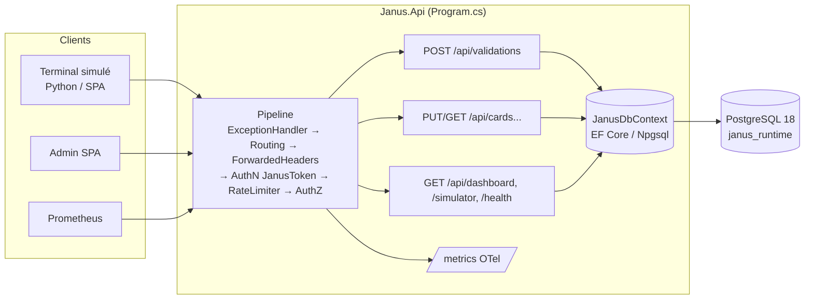
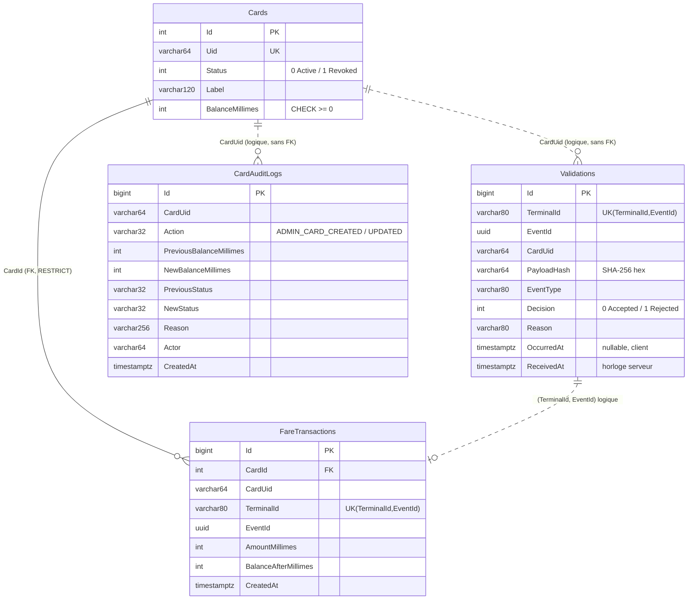
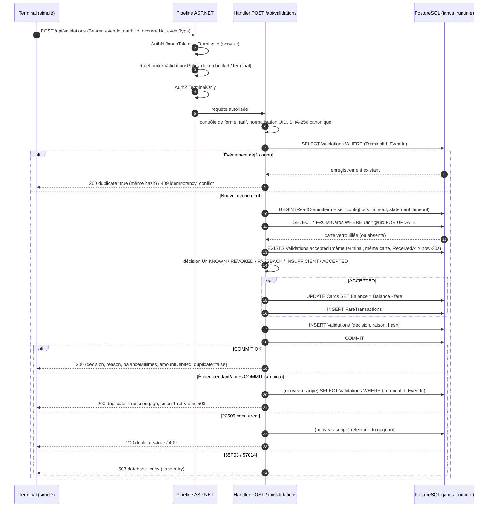

# JANUS — Analyse complète du dépôt (état au commit `3edefe4`)

> **Date d'analyse :** 27 novembre 2026 — **Branche :** `main` (synchronisée avec `origin/main`)
> **Méthode :** lecture directe du code source, des migrations, de la configuration, de la CI et des tests. Aucune modification de code, aucun commit, aucune migration n'a été effectué.
> **Légende :** ✅ **Vérifié** dans le code (référence `chemin:ligne`) · 🔎 **Supposé** (déduction non prouvée par exécution) · ⚠️ partiel · ❌ écart / absent.
> **Secrets :** `.env` et `GEMINI.md` existent à la racine (ignorés par git, `.gitignore`) et **n'ont pas été lus**. Aucun `appsettings*.json` n'existe dans le dépôt.

---

## Sommaire
1. [Cartographie](#1-cartographie)
2. [Architecture](#2-architecture)
3. [Modèle de données](#3-modèle-de-données)
4. [API, authentification et autorisation](#4-api-authentification-et-autorisation)
5. [Flux métier](#5-flux-métier)
6. [Tests](#6-tests)
7. [Qualité et risques](#7-qualité-et-risques)
8. [Écart avec la cible](#8-écart-avec-la-cible)
9. [Tableau « Vérifié / Écart avec le README »](#9-tableau--vérifié--écart-avec-le-readme-)
10. [Top 10 des risques](#10-top-10-des-risques-classés-par-gravité)

---

## 1. Cartographie

### 1.1 Arborescence utile (112 fichiers suivis, 72 commits)
```text
janus-rfid-platform/
├── JanusRfid.slnx                 # Solution : Janus.Api + Janus.Api.Tests
├── compose.yaml                   # 6 services, 2 réseaux, 1 secret, 3 volumes
├── .env.example                   # Modèle de variables (valeurs "change-me")
├── .github/workflows/ci.yml       # 5 jobs CI
├── scripts/init-postgres-least-privilege.sh   # Création du rôle janus_runtime + GRANT
├── monitoring/                    # prometheus.yml, provisioning + dashboard Grafana
├── simulator/                     # janus_simulator.py (CLI), demo_scenario.py (E2E)
├── src/
│   ├── Janus.Api/                 # Backend (TOUT le métier est dans Program.cs)
│   │   ├── Program.cs             # 1291 lignes : config, pipeline, migrations, 14 routes
│   │   ├── Models.cs              # 4 entités, DTO, JanusDbContext
│   │   ├── JanusMetrics.cs        # Instruments OpenTelemetry + hook de test post-COMMIT
│   │   ├── Security/              # Auth Bearer, handler 401/403, provisioning PG, normalisation chemins
│   │   └── Migrations/            # 6 migrations EF Core
│   └── Janus.Web/                 # SPA Angular 19 (dashboard, cards, simulator, audit)
└── tests/
    ├── Janus.Api.Tests/           # 72 tests xUnit (intégration, PostgreSQL réel)
    ├── test_api.py                # 41 tests boîte noire HTTP
    └── verify_metrics.py          # Vérification Prometheus
```

### 1.2 Stack et versions (✅ extraites des manifestes)
| Composant | Version | Source |
|---|---|---|
| Langage / runtime | C# / .NET `net10.0` (SDK local 10.0.115) | `src/Janus.Api/Janus.Api.csproj:2` |
| Framework | ASP.NET Core Minimal APIs | `src/Janus.Api/Janus.Api.csproj:1` (`Microsoft.NET.Sdk.Web`) |
| ORM | EF Core + `Npgsql.EntityFrameworkCore.PostgreSQL` 10.0.0 | `Janus.Api.csproj:4-8` |
| Base de données | PostgreSQL 18 (`postgres:18` compose, `postgres:18-alpine` CI Sonar) | `compose.yaml:3`, `ci.yml:337` |
| Observabilité | OpenTelemetry 1.20.0, exporteur Prometheus 1.20.0-beta.1, Prometheus v2.54.1, Grafana 11.2.0 | `Janus.Api.csproj:11-14`, `compose.yaml:107,135` |
| Tests .NET | xUnit 2.9.3, Mvc.Testing 10.0.13, coverlet 6.0.4 | `tests/Janus.Api.Tests/Janus.Api.Tests.csproj:10-15` |
| Front | Angular ^19.2, TypeScript ~5.7.2, RxJS ~7.8, Karma/Jasmine | `src/Janus.Web/package.json` |
| Serveur web | Nginx 1.27-alpine (build Node 22-alpine) | `src/Janus.Web/Dockerfile` |
| Scripts | Python 3 (stdlib uniquement : `urllib`, `unittest`) | `tests/test_api.py:1-10` |

### 1.3 Points d'entrée
- **API** : `src/Janus.Api/Program.cs` (top-level statements). Retourne `0`/`1` en mode migrateur (`Program.cs:456,501`) ou exécute `app.RunAsync()` (`Program.cs:1290`).
- **Migrateur** : même binaire, avec `Database__MigrateOnly=true` ou `--migrate-only` (`Program.cs:292-293`). Il est utilisé par le service `db-migrator` (`compose.yaml:31-55`).
- **Front** : `src/Janus.Web/src/main.ts`, routes dans `app.routes.ts` (dashboard, cards, simulator, audit).
- **Simulateur terminal** : `simulator/janus_simulator.py` (modes `normal`, `replay`, `conflict`, `revoked`, `unknown`, `bad-token`).

### 1.4 Configuration
- ✅ **100 % par variables d'environnement**, sans `appsettings.json`. Le mapping est fait dans `compose.yaml:61-82` (`Section__Cle`).
- Clés lues par le code : `ConnectionStrings:JanusDb|MigrationDb`, `TerminalAuth:DemoToken|Terminal2Token`, `AdminAuth:DemoToken`, `MetricsAuth:ScrapeToken`, `Fare:AmountMillimes`, `AntiPassback:Enabled|WindowSeconds`, `Database:MigrateOnly|SkipMigration|LockTimeoutMs|StatementTimeoutMs|CommandTimeoutSeconds|MigrationMaxRetries`, `RateLimiting:*`, `ReverseProxy:TrustedProxies|TrustedNetworks`, `Testing:EnableFaultEndpoint`.
- ✅ `ASPNETCORE_ENVIRONMENT` vaut `Development` **par défaut dans tous les services compose** (`compose.yaml:6,35,60`). Les gardes « Production » ne sont donc jamais exercées par le compose par défaut.

### 1.5 Docker / Compose (`compose.yaml`)
| Service | Rôle | Réseau | Port hôte |
|---|---|---|---|
| `db` | PostgreSQL 18 + script d'init du moindre privilège | backend_net | `127.0.0.1:5433` |
| `db-migrator` | One-shot : migrations EF + GRANT, puis sortie avec le code 0 | backend_net | – |
| `api` | API, rôle `janus_runtime`, `SkipMigration=true` | frontend_net + backend_net | `127.0.0.1:5080` |
| `web` | Nginx + SPA, proxy `/api/` et `/health` (pas `/metrics`) | frontend_net (IP fixe 172.28.0.10) | `0.0.0.0:4280` |
| `prometheus` | Scrape `api:8080/metrics` toutes les 2 s avec un secret | frontend_net | `127.0.0.1:9090` |
| `grafana` | Dashboard provisionné | frontend_net | `127.0.0.1:3000` |

Les deux images applicatives tournent sans root : `USER $APP_UID` (`src/Janus.Api/Dockerfile:12`) et `USER nginx` (`src/Janus.Web/Dockerfile`).

### 1.6 CI (`.github/workflows/ci.yml`)
1. **build-dotnet** : `dotnet restore` + `dotnet build -c Release`.
2. **test-and-build-frontend** : Karma headless avec couverture, puis build de production.
3. **integration-tests** : `docker compose up --build`, puis `dotnet test`, `test_api.py`, `demo_scenario.py` et `verify_metrics.py`.
4. **security-scan** : Trivy (SARIF ; bloque uniquement sur les CRITICAL corrigeables).
5. **sonarcloud** : PostgreSQL de service, script d'init, `--migrate-only`, tests avec OpenCover. Le job est ignoré si `SONAR_TOKEN` est absent.

Les actions sont épinglées par SHA (bonne pratique ✅).

---

## 2. Architecture

### 2.1 Vue en couches (réelle)
✅ **Il n'y a pas de couches applicatives.** Les 14 routes sont des lambdas inline dans `Program.cs:505-1288`, qui injectent directement `JanusDbContext`. On n'y trouve ni service métier, ni repository, ni contrôleur, ni validateur dédié. Les règles de tarification, d'anti-passback et d'idempotence sont toutes dans le handler `POST /api/validations` (`Program.cs:971-1288`, environ 320 lignes).



### 2.2 Projets et dépendances
- `Janus.Api` ne dépend d'aucun autre projet.
- `Janus.Api.Tests` → `ProjectReference` vers `Janus.Api` (`Janus.Api.Tests.csproj:22-24`), via `WebApplicationFactory<Program>`.
- `Janus.Web` est indépendant et ne parle à l'API que par HTTP (`proxy.conf.json` vers `localhost:5080` en dev).

### 2.3 Injection de dépendances (✅ `Program.cs:96-259`)
| Service | Durée de vie | Ligne |
|---|---|---|
| `JanusDbContext` (Npgsql, CommandTimeout configurable 1-120 s, 10 par défaut) | Scoped | 97-102 |
| `TimeProvider.System` (remplacé par `SimulatedTimeProvider` en test) | Singleton | 103 |
| `JanusTransactionCommitHook` (point d'injection de panne post-COMMIT pour les tests) | Singleton | 104 |
| `ForwardedHeadersOptions` (proxies et réseaux de confiance) | Options | 107-134 |
| RateLimiter : Global anonyme par IP + 3 politiques par identité | – | 137-245 |
| Authentification `JanusTokenAuthHandler` | – | 248-249 |
| 6 politiques d'autorisation | – | 251-257 |
| `IAuthorizationMiddlewareResultHandler` → JSON 401/403 | Singleton | 259 |
| OpenTelemetry Metrics + exporteur Prometheus | – | 261-276 |

### 2.4 Middlewares (✅ `Program.cs:356-392`)
`UseExceptionHandler` (JSON `internal_error` + `traceId`, sans pile) → `UseRouting` → `UseForwardedHeaders` (seulement si des proxies de confiance sont configurés) → `UseAuthentication` → `UseRateLimiter` → `UseAuthorization`.

### 2.5 Gestion des erreurs
- Les erreurs non gérées passent par le handler global, qui renvoie 500 (`Program.cs:356-377`).
- Les erreurs PostgreSQL sont classées par SQLSTATE (`TryGetPostgresSqlState`, `Program.cs:33-44`) :
  - `23505` : collision d'unicité, réconciliée ;
  - `55P03` / `57014` : timeout de verrou ou d'instruction, réponse 503 `database_busy` sans retry ;
  - `40001` / `40P01` : sérialisation ou deadlock, jusqu'à 2 retries avec backoff de 15 ms × n ;
  - tout le reste : `throw`, donc 500.
- Les timeouts transactionnels sont posés via `set_config('lock_timeout'|'statement_timeout', …, true)` (`Program.cs:68-74`). Les valeurs par défaut sont 5000 ms et 10000 ms, bornées.

### 2.6 Journalisation et observabilité
- `ILogger` structuré, sans secrets. Les événements de sécurité (auth, authz) sont journalisés en Warning (`JanusTokenAuthHandler.cs:111-120`).
- 6 instruments métier (`JanusMetrics.cs`) : `janus_validations_total{decision,reason,terminal_id,duplicate}`, `janus_validation_duration_seconds`, `janus_fare_amount_millimes_total{terminal_id}`, `janus_security_auth_failures_total{endpoint,reason}`, `janus_security_authz_denials_total`, `janus_db_transaction_events_total{operation,outcome}`.
- La cardinalité est bornée grâce à la normalisation des chemins (`SecurityPathHelper.cs`).
- Il n'y a pas de traces distribuées (seul `WithMetrics` est configuré, `Program.cs:263`) ni de logs centralisés. 🔎

---

## 3. Modèle de données

### 3.1 Entités (✅ `Models.cs`)
| Entité (table) | Clé | Champs principaux | Contraintes |
|---|---|---|---|
| `TransitCard` (`Cards`) | `Id int` | `Uid` (64), `Status` (enum int : 0=Active, 1=Revoked), `Label` (120), `BalanceMillimes int` | `IX_Cards_Uid` UNIQUE, `CK_Cards_BalanceMillimes_NonNegative` (≥ 0), défaut 0 (`Models.cs:82-89`) |
| `ValidationEvent` (`Validations`) | `Id bigint` | `TerminalId` (80), `EventId uuid`, `CardUid` (64), `PayloadHash` (64), `EventType` (80), `Decision` (0=Accepted, 1=Rejected), `Reason` (80), `OccurredAt?`, `ReceivedAt` | UNIQUE `(TerminalId, EventId)` ; index `(TerminalId, CardUid, Decision, ReceivedAt)` pour l'anti-passback (`Models.cs:90-99`) |
| `FareTransaction` (`FareTransactions`) | `Id bigint` | `CardId` FK, `CardUid`, `TerminalId`, `EventId`, `AmountMillimes`, `BalanceAfterMillimes`, `CreatedAt` | UNIQUE `(TerminalId, EventId)`, index `CardId`, FK → Cards `ON DELETE RESTRICT` (`Models.cs:100-110`) |
| `CardAuditLog` (`CardAuditLogs`) | `Id bigint` | `CardUid`, `Action` (32), `Previous/NewBalanceMillimes`, `Previous/NewStatus`, `Reason` (256), `Actor` (64), `CreatedAt` | index `CardUid` ; triggers `BEFORE UPDATE/DELETE/TRUNCATE` → exception (migration `20261019215017`) |

**Absences notables (✅ vérifiées) :**
- Pas de FK entre `Validations` ou `CardAuditLogs` et `Cards`, qui sont liées par l'UID texte.
- Pas de CHECK sur `Status`, `Decision` ou `AmountMillimes > 0`.
- Pas de `TenantId`, d'entité terminal, d'utilisateur, de produit ou de tarif.

### 3.2 Diagramme entités-relations


### 3.3 Migrations (6, ✅ `src/Janus.Api/Migrations/`)
| Migration | Contenu |
|---|---|
| `20261015151954_InitialCreate` | Tables `Cards` et `Validations`, index uniques |
| `20261015155513_AddFareTransactionsAndBalance` | `Cards.BalanceMillimes`, table `FareTransactions` + FK |
| `20261015165352_AddCardAuditLogs` | Table `CardAuditLogs` |
| `20261016151210_AddAntiPassbackIndexOnValidations` | Index composite pour l'anti-passback |
| `20261016182125_AddCheckConstraintBalanceNonNegative` | CHECK solde ≥ 0 |
| `20261019215017_AddCardAuditLogsProtectionTrigger` | Triggers append-only + GRANT runtime (SQL brut) |

### 3.4 Moindre privilège PostgreSQL (✅)
- `janus_runtime` (`PostgresLeastPrivilegeProvisioner.cs:256-293`) :
  - `Cards` : SELECT, INSERT, UPDATE ;
  - `Validations`, `FareTransactions`, `CardAuditLogs` : SELECT et INSERT uniquement ;
  - séquences : USAGE et SELECT ;
  - aucun droit sur `__EFMigrationsHistory`, pas de CREATE sur le schéma.
- ⚠️ **La même logique SQL de GRANT existe en trois exemplaires** :
  - la migration `20261019215017` ;
  - `PostgresLeastPrivilegeProvisioner.EnsureProvisionedAsync` ;
  - `scripts/init-postgres-least-privilege.sh`.
  Toute nouvelle table doit être ajoutée aux trois.
- ⚠️ `janus_app` correspond au `POSTGRES_USER` de l'image officielle, **qui est donc superutilisateur** (le README le signale lui-même, §16 risque 3).

---

## 4. API, authentification et autorisation

### 4.1 Authentification (✅ `Security/JanusTokenAuthHandler.cs`)
- Schéma `JanusToken` : en-tête `Authorization: Bearer <jeton>`.
- Les en-têtes `Bearer` vide, non-Bearer ou contenant des espaces sont rejetés, avec une métrique distincte pour chaque raison (`JanusTokenAuthHandler.cs:47-67`).
- La comparaison se fait **en temps constant** (`CryptographicOperations.FixedTimeEquals`, ligne 142) contre **4 jetons statiques de configuration**. Chacun correspond à une **identité codée en dur** :

| Jeton (config) | Identité (`Name`) | Rôle | Permissions |
|---|---|---|---|
| `TerminalAuth:DemoToken` | `TERMINAL-DEMO-01` | Terminal | validations:create, cards:read, dashboard:read |
| `TerminalAuth:Terminal2Token` | `TERMINAL-DEMO-02` | Terminal | idem |
| `AdminAuth:DemoToken` | `ADMIN` | Admin | cards:admin, cards:read, audit:read, metrics:scrape, demo:read, dashboard:read |
| `MetricsAuth:ScrapeToken` | `PROMETHEUS-SCRAPER` | Scraper | metrics:scrape |

- Au démarrage, hors Development (`Program.cs:318-345`), chaque jeton doit faire au moins 16 caractères et ne pas figurer dans la liste des valeurs par défaut. Les 4 jetons doivent être distincts **dans tous les environnements**.
- Il n'y a pas d'expiration, de rotation, de JWT, d'OIDC ni de mTLS.

### 4.2 Politiques (✅ `Program.cs:251-257`)
| Politique | Règle |
|---|---|
| `TerminalOnly` | rôle `Terminal` + `validations:create` |
| `AdminOnly` | rôle `Admin` + `cards:admin` |
| `CardsRead` | `cards:read` (Terminal ou Admin) |
| `DashboardRead` | `dashboard:read` **ou** `cards:read` |
| `AuditRead` | rôle `Admin` + `audit:read` |
| `MetricsScrape` | `metrics:scrape` **ou** rôle `Admin` |

### 4.3 Endpoints (liste complète, ✅ `Program.cs`)
| Méthode | Route | Politique / Rate-limit | Entrée | Sortie / codes | Ligne |
|---|---|---|---|---|---|
| GET | `/health` | Anonyme / Global 30 req/s par IP | – | 200 `{status:"healthy"}` | 505 |
| GET | `/health/live` | Anonyme | – | 200 | 509 |
| GET | `/health/ready` | Anonyme | – | 200 `database:"connected"` ; 503 si la DB est injoignable (timeout 2 s) | 513-533 |
| GET | `/test-fault/unhandled-exception` | Anonyme, **seulement si Development** ou `Testing:EnableFaultEndpoint` | – | 500 JSON masqué | 535-541 |
| GET | `/metrics` | `MetricsScrape` / CardsReadPolicy | – | 200 texte Prometheus ; 401/403 | 390-392 |
| GET | `/api/cards` | `AdminOnly` / AdminPolicy 15 req/s | `page≥1`, `pageSize 1..100` (25), `status` Active/Revoked/ALL, `q` | 200 `PagedResult<AdminTransitCardDto>` ; 400 `invalid_status` | 544-597 |
| GET | `/api/demo/cards` | `AdminOnly` | `limit 1..100` (50), `offset` | 200 tableau `{uid,status,label,balanceMillimes}` | 599-620 |
| GET | `/api/simulator/cards` | `CardsRead` / 60 req/s | `limit 1..50` (20), `offset` | 200 `{uid,status,label}` **sans solde** | 623-643 |
| GET | `/api/simulator/cards/{uid}/presence` | `CardsRead` | uid ≤ 64 | 200 `{uid,status}` ; 400 `invalid_uid` ; 404 `card_not_found` | 646-660 |
| GET | `/api/dashboard/summary` | `DashboardRead` | – | 200 agrégats (validations, débit total, cartes, **masse monétaire**, conflits 409 en mémoire) | 663-695 |
| GET | `/api/cards/{uid}` | `AdminOnly` | `limit`, `offset` | 200 carte + transactions paginées ; 404 | 697-732 |
| GET | `/api/cards/{uid}/audit` | `AuditRead` | `page/pageSize` **ou** `limit/offset` | 200 `{items, auditLogs, page, …}` ; 400 ; 404 | 734-816 |
| PUT | `/api/cards/{uid}` | `AdminOnly` | `CardUpsertRequest {balanceMillimes:int≥0, status?, label?, reason?}` | 200 `{uid,status,label,balanceMillimes}` ; 400 `invalid_uid/invalid_balance/invalid_status` ; 503 `database_busy` | 818-969 |
| POST | `/api/validations` | `TerminalOnly` / ValidationsPolicy (token bucket 30/s, rafale 60) | `ValidationRequest {eventId:uuid, cardUid≤64, occurredAt?, eventType:"TRANSPORT_VALIDATION"}` | 200 `{decision, reason, balanceMillimes, amountDebited, duplicate, receivedAt…}` ; 400 `invalid_request` ; 409 `idempotency_conflict` ; 500 `invalid_fare_configuration` ; 503 `database_busy/database_unavailable` | 971-1288 |

Codes transverses :
- 401 `unauthorized` / 403 `forbidden` avec un message contextualisé (`JanusAuthorizationMiddlewareResultHandler.cs`) ;
- 429 `rate_limit_exceeded` (`Program.cs:139-146`) ;
- 500 `internal_error`.

---

## 5. Flux métier

### 5.1 Validation d'une carte (✅ `Program.cs:971-1288`)
1. **Authentification** : `terminalId` est tiré du jeton (`user.Identity.Name`, ligne 973), jamais du corps JSON.
2. **Validation de forme** (ligne 978) :
   - `eventId ≠ Guid.Empty` ;
   - `cardUid` non vide et d'au plus 64 caractères ;
   - `eventType == "TRANSPORT_VALIDATION"` (valeur figée).
   En cas d'échec : 400, plus une métrique `INVALID_REQUEST`.
3. **Tarif** : lecture de `Fare:AmountMillimes`. S'il est absent ou ≤ 0, la réponse est un **500** (lignes 990-992).
4. **Anti-passback** : actif sauf si `AntiPassback:Enabled` vaut `"false"`. Fenêtre de 30 s par défaut (lignes 994-999).
5. **Normalisation et hash** :
   - `uid = Trim().ToUpperInvariant()` ;
   - JSON canonique `{eventId, cardUid, occurredAt (UTC), eventType}`, puis **SHA-256** hexadécimal (lignes 1001-1003).
6. **Boucle de 3 tentatives au plus**, chacune dans un **nouveau scope DI** (lignes 1057-1060) :
   1. **Pré-contrôle d'idempotence** hors transaction : si `(terminalId, eventId)` existe déjà, la réponse est un 200 `duplicate:true` (hash identique) ou un 409 (hash différent) (lignes 1063-1066, 1008-1055).
   2. `BEGIN` en ReadCommitted, puis `set_config(lock_timeout, statement_timeout)`.
   3. `SELECT * FROM "Cards" WHERE "Uid"=@uid FOR UPDATE` : la ligne de la carte est **verrouillée** (ligne 1073).
   4. Décision dans cet ordre : `UNKNOWN_CARD`, puis `CARD_REVOKED`, puis `PASSBACK_VIOLATION` (une validation *acceptée* existe-t-elle sur **la même borne** et la même carte avec `ReceivedAt ≥ now - fenêtre` ?), puis `INSUFFICIENT_FUNDS`, sinon **ACCEPTED** (raison `ACTIVE_CARD`) (lignes 1077-1114).
   5. Si la validation est acceptée : `Balance -= fare` et INSERT dans `FareTransactions` (lignes 1101-1112).
   6. Dans **tous** les cas : INSERT d'un `ValidationEvent` (lignes 1116-1127), puis `SaveChanges` et `COMMIT`.
   7. Mise à jour des métriques et réponse 200.
7. **Erreurs** :
   - **après** COMMIT (commit ambigu) : relecture dans un scope neuf. Si l'événement est trouvé, on renvoie sa décision (rejeu). Sinon, une seule nouvelle tentative, puis 503 (lignes 1165-1228) ;
   - `23505` / `DbUpdateException` : relecture du gagnant, puis réponse de rejeu ou 409 (lignes 1234-1251) ;
   - `55P03` / `57014` : 503 ; `40001` / `40P01` : retry.



### 5.2 « Recharge » (✅ `Program.cs:818-969`, ⚠️ sémantique)
1. `PUT /api/cards/{uid}` (Admin) avec `balanceMillimes` **obligatoire**, `status`, `label` et `reason` facultatifs.
2. Transaction + `FOR UPDATE` sur la carte. Si la carte n'existe pas, elle est créée (statut `Active` par défaut).
3. **`card.BalanceMillimes = request.BalanceMillimes`** (ligne 881) : c'est une **affectation absolue**, pas un crédit.
4. INSERT d'un `CardAuditLog` (`ADMIN_CARD_CREATED` / `ADMIN_CARD_UPDATED`, ancien et nouveau solde, ancien et nouveau statut, motif, acteur tiré du jeton).
5. Si deux créations concurrentes déclenchent un `23505`, la transaction est rejouée une fois et la seconde opération devient une mise à jour (lignes 924-933).
6. **Côté UI** (`src/Janus.Web/src/app/features/cards/cards.component.ts:367, 396-398, 425-430`) :
   - à l'ouverture de la modale, le solde *lu* est copié ;
   - les boutons « + montant » l'incrémentent **localement** ;
   - la valeur absolue obtenue est ensuite envoyée.
   ➜ **Un débit qui survient entre l'ouverture de la modale et l'envoi est écrasé.** Le verrou `FOR UPDATE` ne protège pas d'une valeur métier périmée envoyée par le client. Voir le risque n°1.
7. Aucun mouvement de crédit n'est écrit dans `FareTransactions`. Seul l'audit en garde la trace.

### 5.3 Révocation
- Elle passe par le même `PUT` avec `status:"Revoked"` (lignes 826-836, 863-865). Le statut est réversible (`Active`).
- Comme `balanceMillimes` est obligatoire (`int` non nullable, `Models.cs:48`), **révoquer réécrit aussi le solde** avec la valeur envoyée par le client (même risque de valeur périmée).
- À la validation suivante, la carte révoquée est rejetée avec `CARD_REVOKED` et un débit nul (ligne 1080). Un événement `Rejected` est tout de même enregistré.
- Il n'y a pas de liste noire diffusée aux terminaux, de motif de révocation typé, ni de date d'effet.

### 5.4 Idempotence (✅)
- La clé est `(TerminalId, EventId)` : index unique sur `Validations` **et** sur `FareTransactions` (`Models.cs:92,102`).
- Le hash SHA-256 du payload canonique distingue le **rejeu exact** (200 `duplicate:true`, avec la décision d'origine et sans nouveau débit) du **conflit** (409).
- La décision est rejouée telle quelle : un rejet `INSUFFICIENT_FUNDS` reste un rejet, même si la carte a été rechargée depuis.
- En cas de course, l'index unique tranche (`23505`), puis une relecture a lieu dans un scope neuf.
- ⚠️ La forme de la réponse de rejeu varie : sans `balanceMillimes` ni `amountDebited` (lignes 1046-1054), alors qu'ils sont présents dans le cas réconcilié (lignes 1031-1044).
- 🔎 La clé ne contient pas l'organisation. En multi-tenant, deux organisations qui partagent un `TerminalId` entreraient en collision.

### 5.5 Anti-passback (✅)
- Il est évalué **sous le verrou de la carte**. Deux validations concurrentes de la même carte sur la même borne sont donc sérialisées : la seconde voit la première une fois celle-ci validée, car ReadCommitted prend un nouveau snapshot à chaque instruction. Ce cas est couvert par `AntiPassbackTests.Test12`.
- La portée est **la même borne uniquement**. Une autre borne accepte la carte dans la fenêtre (`AntiPassbackTests.Test04`).
- Seules les validations **acceptées** ouvrent la fenêtre (`Test07`), et l'horloge utilisée est celle du serveur (`ReceivedAt`), pas `occurredAt`.
- L'idempotence prime sur l'anti-passback (`Test11`).

---

## 6. Tests

### 6.1 Inventaire réel
| Suite | Type | Nombre | Dépendances |
|---|---|---|---|
| `tests/Janus.Api.Tests` (xUnit) | **Intégration** via `WebApplicationFactory` sur un **PostgreSQL réel** (127.0.0.1:5433). Il n'y a aucun test unitaire pur. | **72** (✅ `dotnet test --list-tests`) | PostgreSQL avec les rôles `janus_app` / `janus_runtime` |
| ↳ `AntiPassbackTests` | Horloge simulée, concurrence | 14 | |
| ↳ `FinancialConcurrencyTests` | Doubles débits, rejeu, commit ambigu, 23505, lock_timeout | 11 | |
| ↳ `PaginationTests` | Pagination et RBAC | 10 | |
| ↳ `PostgresSecurityTests` | Privilèges, triggers, gardes Production, MigrateOnly | 15 | Le test 13 exécute le script bash |
| ↳ `SecurityHardeningTests` | RBAC, rate limit, ForwardedHeaders, santé, gestion des exceptions | 22 | |
| `tests/test_api.py` | Boîte noire HTTP | **41** | Stack compose démarrée (API :5080, Nginx :4280) |
| `src/Janus.Web/**/*.spec.ts` | Unitaires Angular (Karma/Jasmine) | **118** | Chrome/Chromium (`CHROME_BIN`) |
| `simulator/demo_scenario.py`, `tests/verify_metrics.py` | Scénario E2E, vérification Prometheus | – | Stack complète |
| **Total** | | **231** | |

### 6.2 Résultats d'exécution dans cet environnement
| Action | Résultat |
|---|---|
| `dotnet build JanusRfid.slnx -c Release` | ✅ **Succès : 0 avertissement, 0 erreur** |
| `dotnet test --list-tests` (découverte seule) | ✅ 72 tests découverts |
| Exécution xUnit / Python | ⏸️ **Non lancée** : elles exigent PostgreSQL sur :5433, qui n'est pas démarré (vérifié par `ss -ltn`), et la stack Docker |
| Exécution Karma | ⏸️ **Non lancée** : aucun Chrome/Chromium installé |

**Aucun résultat de réussite n'est donc affirmé ici.** Le README annonce 72/72, 41/41 et 118/118, ce qui n'a pas été reproduit.

### 6.3 Comment les lancer
```bash
cp .env.example .env                      # puis remplacer les valeurs si besoin
docker compose up -d --build              # db, db-migrator, api, web, prometheus, grafana
dotnet test tests/Janus.Api.Tests -c Release
python3 tests/test_api.py
python3 simulator/demo_scenario.py
python3 tests/verify_metrics.py
cd src/Janus.Web && npm ci --ignore-scripts && CHROME_BIN=/usr/bin/chromium npm test -- --watch=false
docker compose down        # ⚠️ ne PAS ajouter -v si les données doivent être conservées
```

### 6.4 Couverture des flux critiques
| Flux | Couvert | Tests |
|---|---|---|
| Débit nominal, solde insuffisant, révoquée, inconnue | ✅ | AntiPassback 01/05/06, test_api 1-4 |
| Double débit concurrent / solde négatif | ✅ | Financial 02, AntiPassback 12, test_api 8 |
| Rejeu exact et conflit (y compris en concurrence) | ✅ | Financial 03/04, AntiPassback 09-11/13, test_api 5-7/11 |
| Commit ambigu | ⚠️ par injection applicative seulement (pas de coupure TCP réelle) | Financial 09 |
| Admin concurrent avec un débit | ⚠️ teste la cohérence de l'audit, **pas la perte de mise à jour métier due à une valeur absolue périmée** | Financial 01/07 |
| Moindre privilège et immuabilité de l'audit | ✅ | PostgresSecurity 01-10 |
| Champs trop longs dans le PUT (`label` > 120, `reason` > 256) | ❌ non couvert | – |
| Tarif absent | ❌ non couvert | – |

🔎 Les tests xUnit écrivent dans la **même base que le développement** (UID aléatoires, sans nettoyage, `FinancialConcurrencyTests.cs:33-45`). Les données s'accumulent et les tests ne sont pas totalement isolés.

---

## 7. Qualité et risques

### 7.1 Dette technique
- **Monolithe `Program.cs`** de 1291 lignes : routes, règles métier, résilience, migrations et seed dans un seul fichier. La logique de pagination et de lecture de la configuration est dupliquée dans chaque handler.
- **Seed de démonstration dupliquée** (`Program.cs:423-428` et `470-475`).
- **SQL de privilèges triplée** (§3.4).
- **Endpoints hérités** :
  - `/api/demo/cards` fait doublon avec `/api/cards` ;
  - le contrat d'audit est double (`items` + `auditLogs`, `page/pageSize` + `limit/offset`, `Program.cs:742-815`).
- **Incohérence d'horloge** : le PUT utilise `DateTimeOffset.UtcNow` (ligne 897) et le dashboard aussi (ligne 691), au lieu du `TimeProvider` injecté.
- **Enums stockés en int sans CHECK** : l'ajout d'un statut doit être pensé côté base.
- **Raison `ACTIVE_CARD`** pour une validation acceptée : la sémantique est ambiguë.
- **Aucun TODO, FIXME ni HACK** dans le code (recherche `grep` ; la seule occurrence est la chaîne `"Hacked Card"` dans un test).

### 7.2 Sécurité
- ✅ **Points forts** :
  - comparaison en temps constant ;
  - identité tirée du serveur ;
  - gardes de configuration Production ;
  - séparation migrateur / runtime ;
  - triggers d'audit ;
  - rate limiting par identité ;
  - ForwardedHeaders restreint ;
  - en-têtes Nginx (CSP, XFO…) ;
  - images non-root ;
  - Trivy et actions épinglées.
- ❌ **Jetons statiques** sans expiration ni rotation, et **HTTP uniquement** : pas de TLS ni de HSTS (`nginx.conf` écoute sur 8080 en HTTP).
- ❌ **`janus_app` superutilisateur** : il peut désactiver les triggers d'audit.
- ⚠️ `/api/dashboard/summary` est accessible aux **terminaux** et expose `totalCirculatingBalanceMillimes` et `totalDebitedMillimes` (`Program.cs:255, 671-690`).
- ⚠️ Validation d'entrée incomplète :
  - `Label` et `Reason` du PUT ne sont pas bornés : une erreur PostgreSQL 22001 entraîne un `throw` puis une **500** (lignes 876-899, 963-964) ;
  - `GET /api/cards/{uid}` ne vérifie pas la longueur (ligne 698) ;
  - `occurredAt` n'est pas borné dans le passé ou le futur.
- ⚠️ La route `/test-fault/unhandled-exception` est active en Development, et Development est l'environnement par défaut du compose. Elle est exposée sur `127.0.0.1:5080` seulement, pas via Nginx.
- 🔎 Avec de vraies cartes, l'API ne fait confiance qu'à un **UID** clonable : il n'y a pas d'authentification cryptographique de la carte.

### 7.3 Concurrence
| Scénario | État |
|---|---|
| Deux validations simultanées, même carte | ✅ Sérialisées par `FOR UPDATE`, CHECK ≥ 0 en dernier rempart |
| Même événement envoyé deux fois simultanément | ✅ Index unique + réconciliation `23505` |
| Commit ambigu | ✅ Réconciliation dans un scope neuf, sans retry financier aveugle |
| **Admin (valeur absolue lue plus tôt) en concurrence avec un débit** | ❌ **Perte de mise à jour métier** : le débit est annulé par l'écrasement (pas de concurrence optimiste, ni de `expectedBalance`, ni d'opération delta) |
| Deux PUT de création simultanés | ✅ Retry unique sur `23505` |
| Compteur `conflictValidations` | ⚠️ `static` en mémoire (`JanusMetrics.cs:78-83`) : faux en multi-instance et remis à zéro au redémarrage |

### 7.4 Valeurs codées en dur
- Identités `TERMINAL-DEMO-01/02`, `ADMIN`, `PROMETHEUS-SCRAPER` et leurs permissions (`JanusTokenAuthHandler.cs:77-101`).
- `eventType == "TRANSPORT_VALIDATION"` (`Program.cs:978`).
- Fenêtre anti-passback de 30 s par défaut (ligne 996). Fallback `terminalId = "TERMINAL-DEMO-01"` (ligne 973).
- Liste des jetons de développement interdits (lignes 311-316). Retries `maxTransientRetries = 2`, backoff de 15 et 20 ms.
- Clés de verrou consultatif `20261019,1/2`.
- Cartes de démonstration `04A1B2C3D4E5F6` et `04DEAD00000001`.
- Label Prometheus `environment: 'production'` alors que le compose tourne en Development (`prometheus.yml`).
- IP de proxy `172.28.0.10` (compose, `.env.example`).

### 7.5 Code mort / inutile
- `GetAmbiguousCommitRecoveredCount()` (`JanusMetrics.cs:85`) : n'est utilisé que par les tests. 🔎
- La permission `demo:read` est attribuée (`JanusTokenAuthHandler.cs:93`) mais **aucune politique ne l'utilise** ✅.
- `/api/demo/cards` (doublon d'inventaire).

---

## 8. Écart avec la cible

| Point de la vision | ✅ Existe | ⚠️ Partiel | ❌ Manque | Fichiers à toucher |
|---|---|---|---|---|
| **Multi-organisation (multi-tenant)** | – | – | Entité `Organization` ; `OrganizationId` sur toutes les tables ; terminaux, admins et opérateurs **en base** (et non en configuration) ; clé d'idempotence `(Org, Terminal, Event)` ; isolation (filtres EF globaux et/ou RLS PostgreSQL) ; RBAC par organisation | `Models.cs`, nouvelles migrations, `Security/JanusTokenAuthHandler.cs` (réécriture), toutes les routes de `Program.cs`, `PostgresLeastPrivilegeProvisioner.cs` + `scripts/init-postgres-least-privilege.sh` + GRANT de migration, tests |
| **Portefeuille monétaire** | Solde `int` en millimes, CHECK ≥ 0, débit atomique | Le crédit est un **écrasement**, sans écriture de ledger | Entité `Wallet` séparée de la carte ; ledger en partie double (crédit et débit, `BalanceAfter`) ; opérations de crédit idempotentes (`POST …/credits` avec `operationId`) ; réconciliation solde = Σ ledger | `Models.cs`, `Program.cs:818-969` (scinder statut / crédit), `Program.cs:1097-1112`, `cards.component.ts:396-430` |
| **Portefeuille de titres (ex. 10 trajets)** | – | – | Catalogue de produits, contrats ou titres par carte, décompte d'unités, priorité titre / monétaire, validité temporelle | `Models.cs`, nouveau module de tarification, `Program.cs:990-1114` |
| **Modules par secteur** (transport, hôtellerie, événementiel, campus) | – | Anti-passback (spécifique au transport) | `eventType` extensible, règles d'accès par module (zones, créneaux, chambres, billets), stratégie de décision enfichable | `Program.cs:978, 994-1114` → extraire `IValidationRule` / services ; nouveaux projets ou dossiers par module |
| **Interface web d'administration** | SPA Angular 19 : cartes, audit, dashboard, simulateur | Pas de connexion réelle (jetons collés manuellement), rôles Terminal/Admin uniquement | Gestion des organisations, utilisateurs, terminaux, produits et tarifs ; authentification OIDC | `src/Janus.Web/src/app/features/*`, `core/services/session.service.ts`, `auth.interceptor.ts` |
| **Vraies cartes DESFire EV3 et lecteurs** | – | `cardUid` est une chaîne de 64 caractères au plus | Authentification AES (EV2/EV3 Secure Messaging), diversification des clés, SAM, applications et fichiers DESFire par organisation, intégration lecteur (PC/SC ou SDK). L'API devrait recevoir une preuve cryptographique et pas seulement un UID | Nouveau composant `Janus.Edge` / driver ; contrat `ValidationRequest` (`Models.cs:47`) ; gestion des clés hors dépôt |
| **Mode hors ligne / Edge** | Fondations : `eventId` généré par le terminal, idempotence, `occurredAt`, rafale de 60 tokens | – | Endpoint batch de synchronisation différée, listes blanches et noires téléchargeables, politique de conflits (débit hors ligne sur solde insuffisant), décision fondée sur `occurredAt` | `Program.cs` (nouvel endpoint, extraction du cœur de décision), `Models.cs` |
| **HTTPS et déploiement en production** | Gardes Production (jetons, mots de passe DB), migrateur isolé, images non-root, Trivy, healthchecks | Compose en `Development` par défaut, SonarCloud conditionnel | TLS et HSTS (Nginx ou ingress), gestionnaire de secrets, rôle de migration `NOSUPERUSER`, sauvegardes et PRA, logs et traces centralisés, manifeste de déploiement (K8s / PaaS) | `src/Janus.Web/nginx.conf`, `compose.yaml` (ou nouveau `deploy/`), `Program.cs:263` (traces), `scripts/` |

---

## 9. Tableau « Vérifié / Écart avec le README »

| Affirmation du README | Verdict | Détail et preuve |
|---|---|---|
| Solde des cartes en millimes | ✅ Vérifié | `int BalanceMillimes` (`Models.cs:10`), CHECK ≥ 0 (`Models.cs:88`, migration `20261016182125`) |
| Recharge admin auditée | ⚠️ **Partiel** | Auditée ✅ (`Program.cs:888-899`), mais ce n'est **pas une recharge** : c'est une affectation absolue (`Program.cs:881`), sans écriture de ledger |
| Débit par validation | ✅ Vérifié | `Program.cs:1101-1112`, sous `FOR UPDATE` (ligne 1073) |
| Idempotence (TerminalId, EventId) | ✅ Vérifié | Index uniques (`Models.cs:92,102`), hash (`Program.cs:1002-1003`), 409 (`Program.cs:1011-1021`) |
| Refus CARD_REVOKED / INSUFFICIENT_FUNDS | ✅ Vérifié | `Program.cs:1080-1099` ; plus UNKNOWN_CARD et PASSBACK_VIOLATION |
| Anti-passback 30 s | ✅ Vérifié | `Program.cs:996-999, 1085-1092`. Portée : **même borne**, validations acceptées seulement |
| Prometheus / Grafana | ✅ Vérifié | `JanusMetrics.cs`, `prometheus.yml` (secret bearer), dashboard provisionné |
| ≈ 231 tests | ✅ Compté / ⏸️ non exécuté | 72 + 41 + 118 = 231 ; les résultats « PASS » n'ont pas été reproduits ici |
| « Tarif 1500 par défaut ; sinon échec immédiat au démarrage » (README §1.3 et tableau des variables) | ❌ **Écart** | La valeur 1500 n'existe **que dans `compose.yaml:69`**. Si la clé manque, l'API démarre et chaque validation renvoie une **500** `invalid_fare_configuration` (`Program.cs:281-283, 990-992`) |
| Rate limiting et en-têtes testés par `test_api.py` `test_31` à `test_37` (README §5, lignes 247 et 251) | ❌ **Écart** | `test_api.py` ne contient que `test_1` à `test_31`, plus 10 tests nommés. `test_31` porte sur les en-têtes Nginx ; `test_32` à `test_37` n'existent pas |
| « Commits des lots 1 à 2C.1 non poussés », référence `849650e` (README en-tête et §16) | ❌ **Obsolète** | `main` = `origin/main` = `3edefe4` (deux commits après `849650e`) |
| Pipeline ExceptionHandler → … → Authorization | ✅ Vérifié | `Program.cs:356-388` |
| 6 politiques, 3 rôles | ✅ Vérifié | `Program.cs:251-257`, `JanusTokenAuthHandler.cs` |
| Moindre privilège `janus_runtime` | ✅ Vérifié | `PostgresLeastPrivilegeProvisioner.cs:256-293` |
| Migrateur isolé `db-migrator` | ✅ Vérifié | `compose.yaml:31-55`, `Program.cs:395-503` |
| HTTP uniquement, pas de TLS | ✅ Vérifié (limite assumée) | `nginx.conf` écoute en HTTP sur 8080 |

---

## 10. Top 10 des risques (classés par gravité)

| # | Gravité | Risque | Preuve | Remédiation proposée |
|---|---|---|---|---|
| 1 | 🔴 Critique | **Perte de mise à jour financière** : l'admin envoie un solde absolu calculé à partir d'une lecture périmée, ce qui annule les débits intervenus entre-temps (création d'argent). La révocation est aussi concernée | `Program.cs:881`, `cards.component.ts:367,396-430`, `Models.cs:48` | Opération de **crédit delta** idempotente + changement de statut séparé ; ou `expectedBalance` / version (concurrence optimiste) |
| 2 | 🔴 Critique | **Ledger incomplet** : les crédits sont absents de `FareTransactions`, donc pas de réconciliation comptable ni de preuve financière | `Program.cs:872-899` | Ledger en partie double (type CREDIT/DEBIT), invariant solde = Σ mouvements |
| 3 | 🟠 Élevée | **Identités et périmètre codés en dur** : 2 terminaux, 1 admin, pas d'organisation, `eventType` figé. Bloque la vision | `JanusTokenAuthHandler.cs:74-104`, `Program.cs:978` | Terminaux et opérateurs en base, `OrganizationId`, idempotence par organisation |
| 4 | 🟠 Élevée | **Jetons Bearer statiques en HTTP clair** : pas d'expiration, de rotation, ni de TLS | `JanusTokenAuthHandler.cs:69-104`, `nginx.conf` | TLS et HSTS ; JWT / OIDC (admins), mTLS ou jetons par terminal révocables |
| 5 | 🟠 Élevée | **Rôle de migration superutilisateur** : il peut contourner l'immuabilité de l'audit | `compose.yaml:8` (POSTGRES_USER), README §16 | Rôle propriétaire NOSUPERUSER distinct ; export de l'audit vers un puits WORM |
| 6 | 🟡 Moyenne | **Tarif manquant = service dégradé silencieux** (500 sur chaque validation), contraire au README | `Program.cs:281-283, 990-992` | Exiger la clé au démarrage (fail-fast) ; à terme, tarif par produit et par organisation |
| 7 | 🟡 Moyenne | **Validation d'entrée incomplète** : `label` > 120 ou `reason` > 256 donnent une 500 ; uid non borné sur `GET /api/cards/{uid}` ; `occurredAt` libre | `Program.cs:698, 868-878, 963-964` | Validateurs explicites qui renvoient 400 |
| 8 | 🟡 Moyenne | **Agrégats financiers exposés aux terminaux** (masse monétaire, total débité) | `Program.cs:255, 663-695` | Restreindre `DashboardRead` aux admins ou filtrer la réponse selon le rôle |
| 9 | 🟡 Moyenne | **Maintenabilité** : Program.cs monolithique ; SQL de GRANT en trois copies (oubli d'une table → 42501 en production) | `Program.cs`, `PostgresLeastPrivilegeProvisioner.cs`, script `.sh`, migration `20261019215017` | Extraire endpoints et services ; une seule source SQL de privilèges |
| 10 | 🟢 Faible | **État en mémoire et tests non isolés** : compteur de conflits `static` (faux en multi-instance) ; tests xUnit sur la base de dev sans nettoyage | `JanusMetrics.cs:78-83`, `FinancialConcurrencyTests.cs:33-45` | Persister ou ne s'appuyer que sur Prometheus ; base de test éphémère (Testcontainers) |

---

*Fin du rapport. Toutes les références de ligne correspondent au commit `3edefe4`.*
